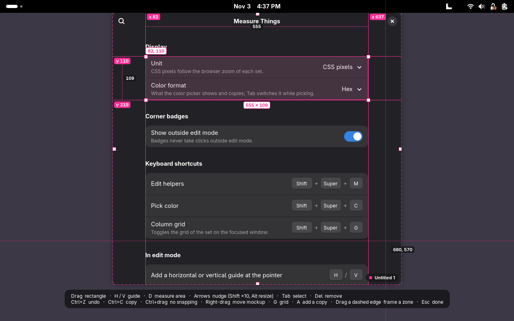
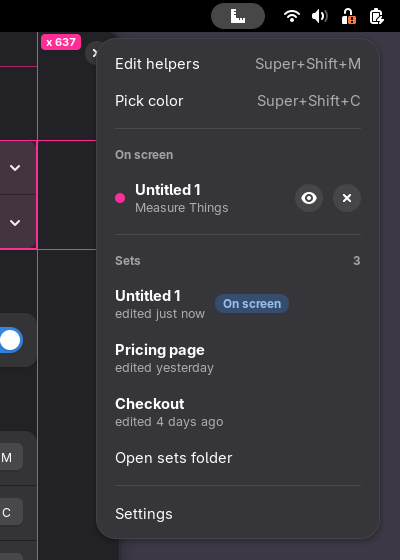
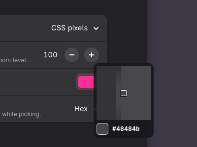
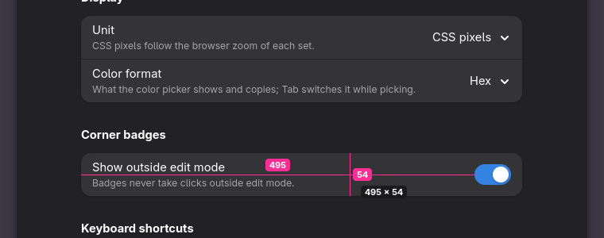

# Measure Things

[](https://github.com/cr0cK/measure-things/actions/workflows/pr-checks.yml)
[](LICENSE)

A GNOME Shell extension with measuring tools for web and UI work. It draws pixel guides, measuring rectangles, a column grid, and a mockup image on any window, measures areas of the screen, and picks colors anywhere on it. Helpers belong to the window they measure and are kept in saved sets. Outside edit mode, clicks go through the helpers, so the page under them stays usable.

<p align="center">
  
</p>

<p align="center">
  
  
</p>

<p align="center">
  
</p>

## Features

- **Sets on windows**: drawing on a window starts a set, `Untitled 1`, saved at once in its own file. Its helpers are drawn inside the window: they move with it, hide behind the windows in front of it, and positions are relative to its top-left corner. A badge in the window's bottom-right corner names the set; in edit mode, a click on it opens the set's menu.
- **Copies**: one set can show on several windows at once. <kbd>A</kbd> in edit mode, or **Add a copy…** in the badge menu, adds a linked copy: it follows the set live, during a drag, and editing it edits the set. Unlink a copy to try changes on its own, then relink it (keeping or discarding what you changed) or **Save as new set…**. Copies last for the session. When the main view's window closes, the oldest linked copy takes over. Comparing two versions of a page, in two windows or in the two views of a split view, shows layout regressions at a glance.
- **Zones**: a view can cover part of a window. In edit mode each view shows a dashed frame with a handle on each edge; drag an edge to frame it, snapping to the screen content, then place the helpers, which follow the zone's top-left corner. **Reset zone** gives the whole window back. Several views can share a window, each in its own zone.
- **Library**: the top bar menu lists the sets on screen, with their number of copies, which the eye hides and ✕ removes from the screen, with their copies, and a click edits in its window, and every saved set, which a click loads onto a window, as a copy when it is on screen already. Sets can be renamed and deleted to the trash, on screen or not, and saved under a new name. A set that cannot go to the trash stays, with a notice.
- **Guides**: horizontal and vertical 1-pixel lines labeled with their position. The gap between neighboring parallel guides is shown live, which makes alignment checks quick.
- **Measuring rectangles**: drag to draw, then move, resize from any edge or corner, or nudge with the arrow keys. The label shows the size, the position too when the rectangle is selected, and the distance to the nearest helper on each side.
- **Area measuring**: press <kbd>D</kbd> in edit mode to see the width and height of the area under the pointer, found from the screen pixels, like a button or a padding. <kbd>Enter</kbd> turns it into a rectangle.
- **Snapping**: dragged guides and rectangle edges snap to the edges of what is on screen. Hold <kbd>Ctrl</kbd> to place them freely.
- **Undo**: <kbd>Ctrl</kbd>+<kbd>Z</kbd> and <kbd>Ctrl</kbd>+<kbd>Shift</kbd>+<kbd>Z</kbd> in edit mode, per set.
- **Click-through**: helpers let the pointer through to their window. Only edit mode captures input.
- **Column grid**: a layout grid (columns, gutter, side margin, optional centered max width) laid over the set's window.
- **Mockup**: lays a design image over the window at its CSS size and half opacity, to compare a page with it. Move it with a right-drag in edit mode. An image replaced at the same path shows its new content.
- **Set settings**: from the badge menu, each set has its name, helper color, browser zoom, grid, and mockup image.
- **Color picker**: a loupe magnifies the pixels under the pointer; a click copies the color as hex, `rgb()`, or `hsl()`.
- **CSS pixels**: values are shown in CSS pixels, so they match your stylesheet on a scaled display (for example 125%). Set the browser zoom of a set when the page is not at 100%, or switch to device pixels in the preferences.
- Sets are JSON files in `~/.local/share/measure-things/sets/`; **Open sets folder** in the menu shows them. After a restart, load a set from the library onto its window again. The helpers, grid, and mockup of version 0.2 become a set named `Untitled 1` on the first start.
- **Files that change outside the shell**: the folder is watched. A file copied in, named differently, or restored from the trash is imported under a fresh ID and a free name, and the original is removed; the same goes for files dropped while the extension was off. When another program edits the file of a set on screen, the set and its linked copies take the file's content, a gesture in progress is cancelled, the dialogs and menus open for the set close, the undo history starts over, and a notice says so. A file removed, or turned unreadable or invalid, takes its set off the screen with a notice. When a save finds the file changed meanwhile, the file on disk wins. A write that fails keeps the set in memory, `Main view · not saved` in its badge menu, and one notice; the next change tries again. A mockup image that cannot be read shows one notice, and its path is kept.

## Usage

| Shortcut | Action |
|---|---|
| <kbd>Super</kbd>+<kbd>Shift</kbd>+<kbd>M</kbd> | Enter or leave edit mode |
| <kbd>Super</kbd>+<kbd>Shift</kbd>+<kbd>G</kbd> | Show or hide the column grid of the focused window's set |
| <kbd>Super</kbd>+<kbd>Shift</kbd>+<kbd>C</kbd> | Pick a color |

The top bar menu has the same actions, the sets on screen, and the library. A set's badge menu, in edit mode, turns its helpers, grid, and mockup on and off, and has **Add a copy…**, **Set settings…**, **Save as new set…**, **Reset zone**, and **Clear helpers**. The badge of a copy has a **Linked** switch, **Reset zone**, **Save as new set…** once unlinked, and **Remove copy**. The shortcuts can be changed in the preferences, which also list the keys of edit mode.

In edit mode, a hint bar lists the keys:

| Input | Action |
|---|---|
| Drag on a window | Draw a rectangle; edges snap to the screen content (<kbd>Ctrl</kbd>: no snapping) |
| Click a badge | Open the set's menu |
| <kbd>H</kbd> / <kbd>V</kbd> | Add a horizontal or vertical guide at the pointer |
| Drag a guide, a rectangle edge, or a corner | Move or resize it |
| Click a rectangle, then drag inside it | Select it, then move it |
| Arrows | Nudge the selection by 1 pixel (<kbd>Shift</kbd>: 10) |
| <kbd>Alt</kbd>+arrows | Resize the selected rectangle |
| <kbd>Tab</kbd> / <kbd>Shift</kbd>+<kbd>Tab</kbd> | Select the next or previous helper |
| <kbd>Delete</kbd> | Remove the selection |
| <kbd>Ctrl</kbd>+<kbd>C</kbd> | Copy the selected size or position |
| <kbd>D</kbd> | Measure the area under the pointer; <kbd>Enter</kbd> adds it as a rectangle |
| <kbd>Ctrl</kbd>+<kbd>Z</kbd> / <kbd>Ctrl</kbd>+<kbd>Shift</kbd>+<kbd>Z</kbd> | Undo or redo |
| Right-drag, <kbd>Ctrl</kbd>+arrows | Move the mockup |
| <kbd>[</kbd> / <kbd>]</kbd> | Lower or raise the mockup opacity |
| <kbd>G</kbd> | Toggle the column grid |
| <kbd>A</kbd> | Add a linked copy of the set edited last on the window under the pointer |
| Drag a dashed zone edge | Frame the view's zone; edges snap to the screen content (<kbd>Ctrl</kbd>: no snapping) |
| <kbd>Esc</kbd> | Cancel the current drag, or leave edit mode |

In the color picker, <kbd>Tab</kbd> switches between hex, `rgb()`, and `hsl()`.

Edit mode acts on the view under the pointer: the smallest zone there. A press on a helper, a badge, or a zone edge keeps its view as the target until the next press elsewhere or until the pointer leaves the window. Positions are relative to the zone's top-left corner. CSS pixel values follow the browser zoom of the set, 100% by default. Area measuring, snapping, and the color picker read a still capture of the screen taken when edit mode or the picker starts.

## Requirements

- GNOME Shell 49 or 50 on Wayland

## Install

Download the latest release and install it:

```sh
curl -fsSLo /tmp/measure-things.zip https://github.com/cr0cK/measure-things/releases/latest/download/measure-things@cr0ck.github.io.shell-extension.zip
gnome-extensions install --force /tmp/measure-things.zip
```

The same commands update an existing install. For a specific version, replace `latest/download`
with `download/vX.Y.Z`.

To install from a checkout instead, run `make install` from the repository root.

Log out and back in (Wayland cannot restart GNOME Shell in place), then enable the extension:

```sh
gnome-extensions enable measure-things@cr0ck.github.io
```

## Development

See [CONTRIBUTING.md](CONTRIBUTING.md): `npm run lint`, `make check`, `scripts/e2e.sh` for the headless end-to-end test, and `scripts/sandbox.sh` to try a change in a windowed GNOME Shell.

## License

[MIT](LICENSE)
