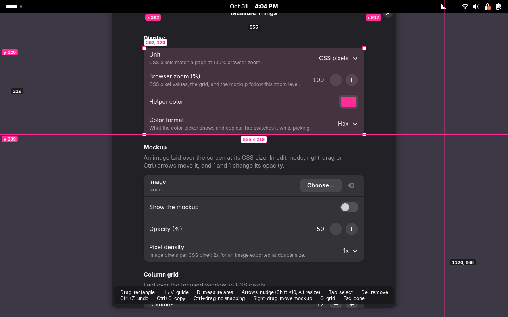
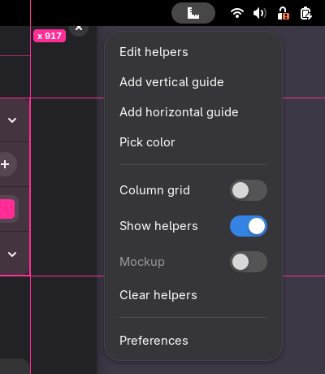
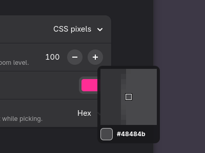
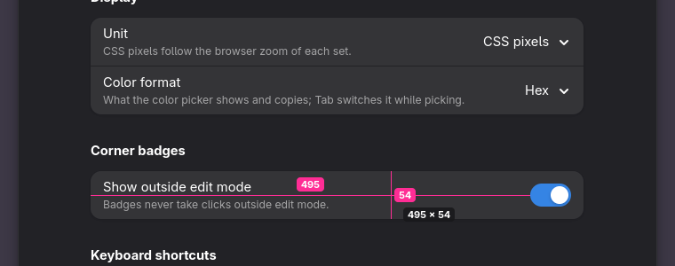

# Measure Things

[](https://github.com/cr0cK/measure-things/actions/workflows/pr-checks.yml)
[](LICENSE)

A GNOME Shell extension with measuring tools for web and UI work. It draws pixel guides, measuring rectangles, a column grid, and a mockup image above every window, measures areas of the screen, and picks colors anywhere on it. Outside edit mode, clicks go through the helpers, so the page under them stays usable.

<p align="center">
  
</p>

<p align="center">
  
  
</p>

<p align="center">
  
</p>

## Features

- **Guides**: horizontal and vertical 1-pixel lines labeled with their position. The gap between neighboring parallel guides is shown live, which makes alignment checks quick.
- **Measuring rectangles**: drag to draw, then move, resize from any edge or corner, or nudge with the arrow keys. The label shows the size, the position too when the rectangle is selected, and the distance to the nearest helper on each side.
- **Area measuring**: press <kbd>D</kbd> in edit mode to see the width and height of the area under the pointer, found from the screen pixels, like a button or a padding. <kbd>Enter</kbd> turns it into a rectangle.
- **Snapping**: dragged guides and rectangle edges snap to the edges of what is on screen. Hold <kbd>Ctrl</kbd> to place them freely.
- **Undo**: <kbd>Ctrl</kbd>+<kbd>Z</kbd> and <kbd>Ctrl</kbd>+<kbd>Shift</kbd>+<kbd>Z</kbd> in edit mode.
- **Click-through**: helpers stay on screen above every window, including fullscreen ones, and let the pointer through to the windows below. Only edit mode captures input.
- **Column grid**: a layout grid (columns, gutter, side margin, optional centered max width) laid over the focused window, which follows it when it moves or resizes.
- **Mockup**: lays a design image over the screen at its CSS size and half opacity, to compare a page with it. Move it with a right-drag in edit mode.
- **Color picker**: a loupe magnifies the pixels under the pointer; a click copies the color as hex, `rgb()`, or `hsl()`.
- **CSS pixels**: values are shown in CSS pixels, so they match your stylesheet on a scaled display (for example 125%). Set the browser zoom in the preferences when the page is not at 100%, or switch to device pixels.
- Helpers are saved and come back after a restart or a lock.

## Usage

| Shortcut | Action |
|---|---|
| <kbd>Super</kbd>+<kbd>Shift</kbd>+<kbd>M</kbd> | Enter or leave edit mode |
| <kbd>Super</kbd>+<kbd>Shift</kbd>+<kbd>G</kbd> | Show or hide the column grid over the focused window |
| <kbd>Super</kbd>+<kbd>Shift</kbd>+<kbd>C</kbd> | Pick a color |

The top bar menu has the same actions, plus **Add vertical guide**, **Add horizontal guide**, **Show helpers**, **Mockup**, and **Clear helpers**. The shortcuts can be changed in the preferences, which also list the keys of edit mode and where the mockup image is chosen.

In edit mode, a hint bar lists the keys:

| Input | Action |
|---|---|
| Drag on empty space | Draw a rectangle; edges snap to the screen content (<kbd>Ctrl</kbd>: no snapping) |
| <kbd>H</kbd> / <kbd>V</kbd> | Add a horizontal or vertical guide at the pointer |
| Drag a guide, a rectangle edge, or a corner | Move or resize it |
| Click a rectangle, then drag inside it | Select it, then move it |
| Arrows | Nudge the selection by 1 pixel (<kbd>Shift</kbd>: 10) |
| <kbd>Alt</kbd>+arrows | Resize the selected rectangle |
| <kbd>Tab</kbd> / <kbd>Shift</kbd>+<kbd>Tab</kbd> | Select the next or previous helper |
| <kbd>Delete</kbd> | Remove the selection |
| <kbd>Ctrl</kbd>+<kbd>C</kbd> | Copy the selected size or position |
| <kbd>D</kbd> | Measure the area under the pointer; <kbd>Enter</kbd> adds it as a rectangle |
| <kbd>Ctrl</kbd>+<kbd>Z</kbd> / <kbd>Ctrl</kbd>+<kbd>Shift</kbd>+<kbd>Z</kbd> | Undo or redo |
| Right-drag, <kbd>Ctrl</kbd>+arrows | Move the mockup |
| <kbd>[</kbd> / <kbd>]</kbd> | Lower or raise the mockup opacity |
| <kbd>G</kbd> | Toggle the column grid |
| <kbd>Esc</kbd> | Cancel the current drag, or leave edit mode |

In the color picker, <kbd>Tab</kbd> switches between hex, `rgb()`, and `hsl()`.

Positions are relative to the monitor they are on. CSS pixel values follow the browser zoom set in the preferences, 100% by default. Area measuring, snapping, and the color picker read a still capture of the screen taken when edit mode or the picker starts.

## Requirements

- GNOME Shell 49 on Wayland

## Install

Download the latest release and install it:

```sh
curl -fsSLo /tmp/measure-things.zip https://github.com/cr0cK/measure-things/releases/latest/download/measure-things@cr0ck.github.io.shell-extension.zip
gnome-extensions install --force /tmp/measure-things.zip
```

The same commands update an existing install. For a specific version, replace `latest/download`
with `download/vX.Y.Z`.

To install from a checkout instead, run `make install` from the repository root.

Log out and back in (Wayland cannot restart GNOME Shell in place), then enable the extension:

```sh
gnome-extensions enable measure-things@cr0ck.github.io
```

## Development

See [CONTRIBUTING.md](CONTRIBUTING.md): `npm run lint`, `make check`, `scripts/e2e.sh` for the headless end-to-end test, and `scripts/sandbox.sh` to try a change in a windowed GNOME Shell.

## License

[MIT](LICENSE)
