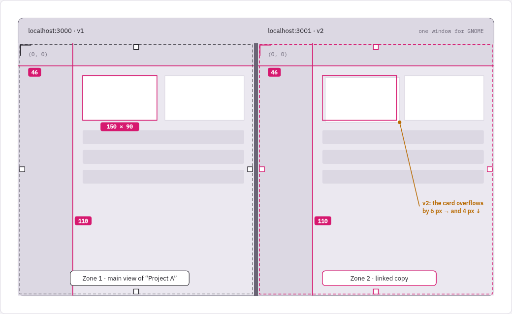
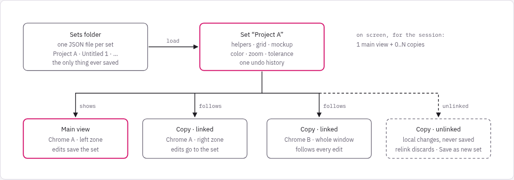
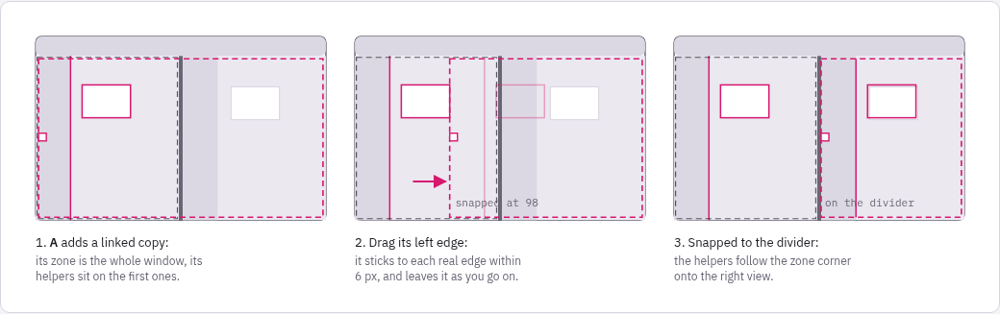
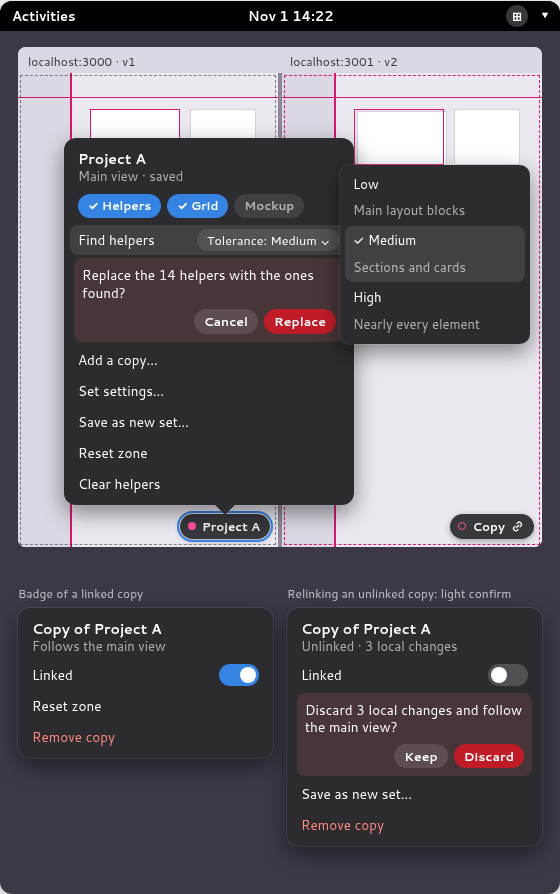
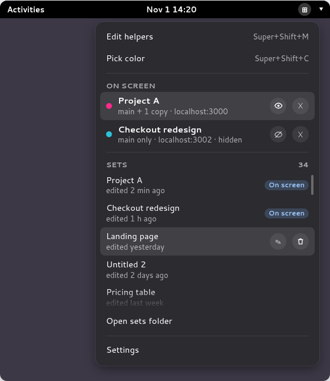
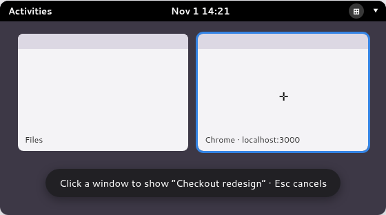
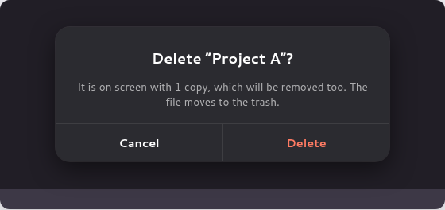
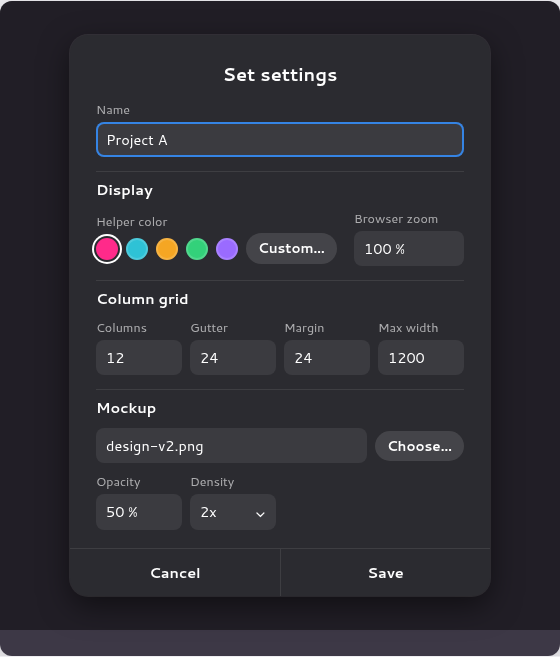
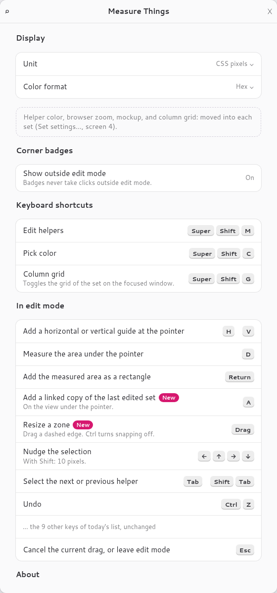

# Measure Things — SET specification

Window-scoped helpers in saved sets, with a main view and session copies per set. It replaces
these sections of PIX: Layer, Helpers, Units, Edit mode, Column grid, Mockup, and Preferences, and
the color picker's rule on hiding the layer, which were removed from PIX once SET was
implemented.

## Goal

Measure and check the alignment of any UI element on screen, a web page in a browser above all,
without leaving the page. Version 0.3 ties the helpers to the page they measure: helpers belong to
a window, or to a zone of it, they are kept in saved sets, and one set can show on several windows
or views at once. Comparing two versions of a page, side by side in two windows or in the two views
of a Chrome split view, then shows layout regressions at a glance.

The images are mockups. Where an image and the text disagree, the text wins.

## Audience and environment

- Web and UI developers on GNOME Shell 49 or 50, Wayland.
- Single and multi-monitor setups, at any monitor scale, fractional ones included.

## Vocabulary

- **Set**: a saved collection of helpers with its column grid, mockup, and display settings. A
  set is one file in the sets folder. Sets are the only content Measure Things saves; the
  preferences hold its settings.
- **View**: a set shown on a window, inside a zone of that window.
- **Zone**: the rectangle of a window a view is drawn in. It is the whole window by default.
- **Main view**: the one view of a set on screen that carries the set's own badge, and stays when
  its copies go. Its edits save the set, as a linked copy's do.
- **Copy**: any other view of the same set. Copies last for the session and are never saved.
  A copy is **linked** or **unlinked**.

## Sets

- A set holds:
  - a name;
  - guides and rectangles;
  - the helper color and the browser zoom;
  - the column grid settings, and whether the grid shows;
  - the mockup: image path, position, opacity, pixel density, and whether it shows;
  - whether the helpers show outside edit mode;
  - the last tolerance used by **Find helpers**.
- Sets live in `$XDG_DATA_HOME/measure-things/sets/`, one JSON file per set, named after its ID.
  Each file holds a stable ID, a schema version, a revision, and the time it was last edited or
  loaded.
- Every change is committed when a gesture ends, or when a discrete command runs: a drag released,
  a key, a menu action, the settings dialog saved. A pointer motion never writes. A commit
  rewrites the file atomically, with `Gio.File.replace_contents_bytes_async` and the etag of the
  last successful read or write of that file, and increments its revision once per commit.
  Loading a set is a write too: it updates the time last loaded and increments the revision.
- Writes of one file go through one queue, kept across a disable and re-enable: one write at a
  time, each starting once the previous one ended, with the etag it left. Commits that have not
  started yet merge into the latest state, so one write carries them all.
- For each file, the shell keeps the etag and the text of its last successful read or write. A
  folder event is judged only once that file's queue is idle, against the file as it is then:
  when it has that etag or that text, the event is the shell's own write, or no change, and is
  ignored. Events of earlier writes in the queue are judged the same way, so they never count as
  external. This holds across a disable and re-enable.
- A file is identified by its name, `<id>.json`. The shell watches the folder, and acts on a name
  once its events settle: on `CHANGES_DONE_HINT`, or after about 300 ms without an event. A file
  that disappears and comes back within that time is changed, not removed.
  - A new file whose name matches the ID it holds, and whose ID is free, appears in the library.
  - Any other new file is an import: a copy of an existing set, a file named differently, and a
    file holding an ID removed during this session, by the shell or by another program, such as a
    set restored from the Trash. The copy is a new file: a fresh ID, revision 0, `edited` set to
    the import time, and no `migrated` field. `<new id>.json` is written first, then the original
    is removed. When removing it fails, `<new id>.json` is removed again, so a later scan never
    imports it twice, and the original shows as unavailable.
  - Before the original is removed, it is read again, and a disable does not cancel that read.
    When another program changed it since it was copied, it is kept, and its own events import it
    in turn; the copy of the older content stays as a set. The instant between that read and the
    removal is a residual race, accepted.
  - A change to an existing file that makes its ID differ from its name removes the set it held,
    whose views leave the screen, and imports the file.
  - The startup scan applies the same rules, so files dropped while the shell or the extension was
    off are imported then.
  - A file that turns from unavailable to valid is read as a new file, under the rules above.
  - A change to an existing file by another program replaces the set in memory and its linked
    copies. A gesture in progress on that set is cancelled, every dialog and menu open for it
    closes without applying (see below), and the set's undo history starts over. A notice says
    so. An unlinked copy is not affected: its gesture, local changes, and history stay.
  - A commit whose etag no longer matches the file is dropped, with every commit made from the
    state the file has left: those merged into the same write, those queued after it, those made
    while the file is read again, and those held by a deletion in progress. The failed write itself
    reloads the file from disk, replaces the set in memory with it, so nothing stale is written with
    the new etag, starts the undo history over, and shows one notice that counts every commit it
    dropped; the folder event that follows is ignored. A conflict is not a failed write, and does
    not set `not saved`.
  - A file removed there removes its set: its views leave the screen, unlinked copies included,
    with a notice that counts the local changes lost.
  - A commit whose file no longer exists, before its removal has settled, is dropped and never
    recreates the file: the set is removed as above. GIO's replace recreates a missing file even
    with an etag, so each write to a file already read or written first checks that it still
    exists. A first write creates the file, and the sets folder when it is missing. A file
    removed in the instant between that check and the write is recreated by the write; that
    residual race is accepted. Once a removal has settled, a file that comes back is judged as
    an import, never as the shell's own write, whatever its text. The ID of every set in the
    library whose file's removal settled, whether the shell or another program removed it, stays
    covered by a tombstone for the rest of the shell's session, across a disable and re-enable: a
    file that comes back with it is imported under a fresh ID, and the removed set's views stay
    gone. A file that was unavailable when it was removed holds no set, and leaves no tombstone.
  - When the sets folder itself is removed or moved away while the shell runs, every file it held
    is judged removed, under the rule above. The next write creates the folder again and watches
    it again.
- When a set is replaced, removed, or made unavailable, every dialog and menu open for it closes
  without applying: **Set settings**, rename, the delete confirmation, the **Save as new set…**
  name dialog, and its badge menu. A file chooser answer that arrives later is ignored. Rename and
  delete look the set up by ID again when confirmed.
- A file that cannot be read, is invalid, is over the size limit, or has a newer schema version,
  shows as unavailable in the library. It is never written to and cannot be loaded. When a set on
  screen becomes unavailable, its views leave the screen with a notice.
- A file is invalid when it is not a JSON object, or when a stored field is missing, of the wrong
  type, or out of its range: the ranges of [Set settings](#set-settings), an ID of 1 to 64
  characters among `A-Z`, `a-z`, `0-9`, and `-`, a non-empty name of at most 200 Unicode
  characters, a rectangle of a positive size, and at most 1,000 helpers. Unknown fields of a valid
  file are ignored, and dropped by its next write. The field names are those of schema version 1,
  defined by the set codec.
- A set has at most 1,000 helpers, and its file at most 1 MiB. An action that would go past a
  limit is refused with a notice. The limits apply to every commit, an unlinked copy's included.
- A name the user enters, or the shell makes, is trimmed of surrounding whitespace, and cut to 200
  characters; a name of whitespace only counts as empty. A name read from a file is not normalized:
  past 200 characters, or empty once trimmed, the file is invalid. A numeric suffix shortens the
  name before it, so the whole stays within 200 characters.
- Two sets never share a name. A name that is already taken gets a numeric suffix, `Project A 2`,
  when a set is created, renamed, or found in the folder. Among files found together with the
  same name, by the startup scan, the one edited earliest keeps it, then the lower ID. A file
  found while the shell runs, new or edited by another program, never takes a name from a set
  already in the library or on screen: the file gets the suffix. A suffix given to a file found
  in the folder is written to that file once, the reload after a conflict included. That write
  increments the revision by one and keeps `edited`: a suffix is not an edit.
- Nothing reattaches after a restart: windows have no stable identity. The user loads a set onto
  a window from the menu.

### New sets

- The first committed content action at a point of a window that no zone covers creates a set
  named `Untitled N`, with N one more than the highest existing `Untitled` number. That window
  becomes its main view, with an automatic zone. This covers a window without any view, and the
  part of a window that its fixed zones leave uncovered.
- The content actions are adding a helper (drawing, `H`, `V`, `Enter` on a measured area) and
  turning the grid on (`G`, or the grid shortcut on the focused window). Entering edit mode,
  moving the pointer, and cancelling create nothing. A mockup needs an existing set: it is chosen
  in **Set settings**.
- A new set gets the next color of the palette that no set on screen uses: `#ff2d95`, `#2ec2d6`,
  `#f5a623`, `#33d17a`, `#9a6bff`. When all five are on screen, it takes the first.
- Other defaults: browser zoom 100%, grid of 12 columns, 24 px gutter, 24 px side margin, full
  width, grid hidden, no mockup (opacity 50% and density 1x once one is chosen), helpers shown,
  tolerance Medium.

## Views and copies

- A set on screen has one main view and any number of copies. Several sets can be on screen at
  once, such as set A on the left view of a window and set B on the right one.
- A window can hold several views. Each has its own zone.
- Editing the main view saves the set, and every linked copy follows live, during the drag.
- A **linked** copy shows the set. Editing a linked copy edits the set, exactly as if the main
  view had been edited.
- An **unlinked** copy holds a full copy of the set's content (everything listed under
  [Sets](#sets) but the name), taken when it is unlinked. From then on, changes to the set don't
  reach it, and its own changes don't reach the set. They stay in memory and are never saved.
- An unlinked copy's **local changes** are its commits since it was unlinked, minus the ones it
  undid. Its badge shows their count. The count is kept apart from the undo history, so it stays
  right past the history's 100 states.
- **Relinking** a copy without local changes is immediate. With local changes, a light
  confirmation comes first, in place: *Keep* leaves the copy unlinked and unchanged, *Discard*
  drops its changes and the copy shows the set again.
- **Save as new set…** asks for a name in a dialog, prefilled with the set's name followed by a
  numeric suffix. An empty name keeps the prefilled one. The views switch to the new set at once, so
  later commits go to it, then its file is written. If the write fails, the new set stays in memory
  as `not saved` (see [Lifecycle](#lifecycle)), and the next commit tries again.
  - On an unlinked copy, the copy becomes the main view of the new set, with its content and its
    undo history. The original set and its other views don't change.
  - On the main view, the set's current content is saved under the new name. The main view, its
    linked copies, and its unlinked copies switch to the new set, with their zones, hidden state,
    local changes, and undo histories. The old set keeps what its file last held.
- **Add a copy…** closes the menu and shows a crosshair, without leaving edit mode. The hint bar
  reads `Click a window to add a copy of “<set>” · Esc cancels`. A click on a window adds a
  linked copy there, with an automatic zone. `Esc`, or a click outside any window, cancels. Edit
  mode then goes on.
- `A` in edit mode adds a linked copy of the set edited last, on the window under the pointer.
  The set edited last is the set of the last committed content change, made on its main view, a
  linked copy, or an unlinked copy. Before any such change, it is the set loaded or created last.
  When that set leaves the screen, `A` shows a notice and does nothing until another set is
  edited.
- **Remove copy** removes one copy. When it is unlinked with local changes, a light confirmation
  comes first.
- When the main view's window closes, the oldest linked copy becomes the main view. Without a
  linked copy, the set leaves the screen, and its unlinked copies leave with it.
- Undo history belongs to the set: the main view and its linked copies share it. An unlinked copy
  starts its own when it is unlinked. Relinking or removing the copy drops it. See
  [Undo](#undo) for what it covers.

## Rendering

- Views go on normal, dialog, modal dialog, and utility windows; edit mode targets, the grid
  shortcut, and loading use that one list. Popup menus, dropdown menus, combo boxes, tooltips,
  menus, and override-redirect windows block the windows below them. Every other window type, such
  as docks, the desktop, toolbars, and splash screens, is transparent to targeting. Blocking only
  matters for windows that stay mapped once edit mode takes its grab; the other blocking types and
  override-redirect windows come from XWayland, and are not verified. Wayland windows are supported.
  XWayland windows work on a best-effort basis and are not verified.
- A view draws its helpers inside its window, as children of the window's actor, clipped to its
  zone. Helpers move with the window. Windows in front hide them. They follow the window across
  workspaces, and hide while it is minimized. No line crosses the whole screen any more.
- A view's actors are attached to the window only while it shows something. Mutter does not scan
  out a window directly when its actor has an extra child, even a hidden one.
- Popups that a page draws inside its own content, such as HTML dropdowns, stay beneath the
  helpers. Native popup menus show above them.
- Views of one window stack the largest zone at the bottom and the smallest on top, the newest on
  top among equal sizes, so the view drawn on top is the one edit mode targets, unless a latched
  or last-targeted view takes precedence (see [Edit mode](#edit-mode)). Badges stack above every
  view of their window.
- Outside edit mode nothing is reactive: clicks, scrolling, and hovering reach the window below.

## Coordinates and units

- Helper geometry is stored in CSS pixels, relative to the top-left corner of the zone, at the set's
  browser zoom. A view converts it to stage pixels with the zoom and, in physical layout mode, the
  scale Mutter draws its window at: the highest scale among the monitors the window frame touches,
  so a window across two monitors uses the higher one. A set therefore looks the same on any window,
  monitor, or scale, and changing the set's zoom rescales its helpers around the zone's corner, as
  the page does.
- Positions in labels, the readout, and `Ctrl+C` are relative to the zone's top-left corner.
  Sizes and distances use the display unit.
- **CSS pixels** (default): CSS pixels at the set's browser zoom. **Device pixels**: physical screen
  pixels, at the scale Mutter draws the view's window at, as above, in both layout modes. Values are
  rounded to two decimals, without trailing zeros.
- Layout mode comes from Mutter's `scale-monitor-framebuffer` feature, as in v0.2.
- Interaction steps and tolerances stay in stage pixels, as in v0.2: arrow nudges (1, or 10 with
  `Shift`), the 3-pixel drag threshold, the 4-pixel edge and handle boxes, the 6-pixel snapping
  distance, the 1-pixel minimum rectangle size, and mockup moves. The result of a gesture is
  converted to CSS pixels and stored rounded to two decimals.

## Zones

- A new view's zone is **automatic**: it is the whole window, and follows its resizes.
- In edit mode a zone shows as a dashed frame, with a handle in the middle of each edge, drawn
  inside the window.
- Dragging an edge resizes the zone, with snapping to screen edges anywhere in the window frame
  (`Ctrl` turns it off), and makes the zone **fixed**. Nothing is detected automatically: the edge
  stays where it is released.
- While an edge is dragged, the zone stays within the window frame and at least 40 × 40 stage
  pixels, or the whole frame when the window is smaller. A fixed zone that lies partly outside
  the frame first becomes its intersection with the frame, grown back to 40 × 40 when smaller,
  when one of its edges starts being dragged; then the edge moves. When its corner was outside the
  frame, the corner moves, and the helpers with it.
- A fixed zone is stored in the window actor's units, stage pixels divided by k, the scale of the
  actor's children: 1 in logical layout mode, the window's geometry scale in physical layout mode.
  It is rounded to whole stage pixels when the drag ends, so it stays on the content when the window
  changes scale or monitor. Its corner goes through the same transform as the helpers. The 40 × 40
  minimum and snapping stay in stage pixels.
- A fixed zone keeps its stored position and size, relative to the window's top-left corner, when
  the window is resized or a split view's divider moves. What shows, and what edit mode targets,
  is its intersection with the window frame. When that intersection is empty, the view shows
  nothing, and **Reset zone** in its badge brings it back.
- **Reset zone** makes the zone automatic again. It is unavailable while the zone is automatic.
- Helpers always follow the zone's top-left corner. The workflow is to frame the zones first,
  then place the helpers.
- A helper outside its zone is hidden, but still stored.
- Hit testing, `Tab` cycling, area measuring, helper snapping, and gap labels stay within the
  zone's visible part. A helper that intersects it takes part; a hidden one is neither selectable
  nor a neighbor for gap labels.
- Resizing a zone is not a change of the window's geometry: it cancels no gesture and takes no
  new snapshot.
- Zones are session-only, like views.

## Helpers

- A vertical guide is a 1-pixel line across its zone at an x position, labeled `x <position>` at
  the top of the zone. A horizontal guide is the same at a y position, labeled `y <position>` at
  the left of the zone.
- Neighboring parallel guides show the distance between them on a line joining them. A distance
  line, between guides or from a selected rectangle, is the set's color at 60% opacity, and ends in
  a filled arrowhead at each end, 5 stage pixels long and 5 wide, in the set's color, opaque, its
  tip on the edge the line reaches, so it never reads as a guide. A line shorter than 12 stage
  pixels has no arrowheads.
- A selected rectangle shows the distance to its nearest neighbor on each side: a guide, or a
  rectangle that overlaps it across the gap. Touching or overlapping neighbors show nothing.
- A rectangle is a 1-pixel outline with a light fill, labeled with its size, `width × height`,
  below it, or above its bottom edge when its zone ends first. When selected, it also shows its
  top-left position and corner handles.
- Helpers use the set's color.

## Edit mode

- Entered with the edit shortcut (`Super+Shift+M`), **Edit helpers**, or a click on a set in
  the menu's **On screen** list. It takes a modal grab.
- Edit mode shows every view, hidden sets included, and every badge.
- **Targeting**: the target is the topmost visible window under the pointer. Inside it, the
  target is the smallest zone under the pointer, the newest on equal sizes. The panel, the
  desktop, and the overview are never targets, and a blocking window in front of a window blocks
  it (see [Rendering](#rendering)).
- **Priority** under the pointer, over every view of the target window: a badge first, then a
  zone edge, within 4 pixels along its whole length, then helpers, then the zone that targeting
  picks. Equal hits are hits of the same class, two badges, two edges, or two helpers; the zone
  class holds one view, the one targeting picks, so a larger zone never wins over a smaller one
  inside it. Among equal hits, the view targeted last, the latched view or else the current target,
  wins, then the view stacked higher: the smaller zone, then the newer. So the edge of a larger zone can be dragged from inside a smaller one,
  and coinciding edges belong to the view being worked on.
- A zone edge is grabbed only once the pointer has moved 3 pixels from the press. A press on an
  edge released before that acts as a press on what lies under the edge: a helper, or the zone.
- A press on a helper, a badge, or a zone edge latches a view as the target until the next press
  elsewhere, or until the pointer leaves the window: the view of what the press acts on, so a
  press on an edge released before 3 pixels latches the view of the helper under it, or else the
  zone targeting picks.
- While the pointer is outside the latched view's visible zone, `H`, `V`, `D`, and `Enter` do
  nothing, and the readout shows nothing.
- A point of a window that no zone covers targets the window alone. There, drawing, `H`, `V`,
  `Enter` on a measured area, and `G` create a set (see [New sets](#new-sets)), `D` measures
  areas within the window frame, `A` adds a copy, and the other keys do nothing.
- The selection belongs to one view. When the target changes to another view, latching included, the
  selection is cleared. Copy, nudge, delete, and `Tab` act on the target view's selection only.
- A gesture latches its view, set, helper, and coordinate transform when it starts, and keeps them
  until it ends. If the target window moves, resizes, changes scale, or changes monitor during the
  gesture, the gesture is cancelled, as with `Esc`.
- The pointer is a crosshair with lines across the monitor and a readout of the position
  relative to the target zone. Over no window, the readout shows nothing. A hint bar lists the
  keys.
- Dragging on empty space, or inside a rectangle that is not selected, draws a rectangle once the
  pointer has moved 3 pixels. A click without drag selects the rectangle under the pointer, or
  clears the selection.
- Dragging a guide moves it along its axis. Dragging a rectangle edge or corner resizes it, within
  4 pixels of the edge. Dragging past the opposite edge flips it, and it keeps at least 1 pixel.
  Dragging inside the selected rectangle moves it. The topmost helper wins.
- **Snapping**: a dragged guide, rectangle edge, corner of a new rectangle, or zone edge snaps to
  the nearest screen edge within 6 stage pixels. A screen edge is the boundary between two pixels
  whose colors differ by more than 12 on a channel. Vertical edges are searched on the pointer's
  row, horizontal ones on its column: within the zone's visible part for helpers, within the window
  frame for zone edges. Moving a whole rectangle does not snap. Holding `Ctrl` while dragging turns
  snapping off.
- A dragged guide also snaps to a long edge anywhere along it: a boundary that is a screen edge on
  at least 16 consecutive stage pixels (`16 × scale` device pixels, rounded up) of the zone's
  visible part, so an edge that ends above or below the pointer counts, and most text does not.
  Candidate boundaries are the same as on the pointer's row or column, within the same bounds, and
  convert to a stage position the same way. The nearest edge within 6 stage pixels wins, from the
  pointer's row or column or a long one; at equal distance, the one first in reading order, left or
  top. Rectangle edges and zone edges search the pointer's row or column only.
- The pixels a guide's long edges need, the band within 6 stage pixels of it across the zone's
  visible part, are read once per position, like a line, and a drag released while they are read
  finishes after the read, as for a line. A read that fails adds no long edge.
- **Measuring areas**: `D` toggles area measuring. The crosshair is replaced by the extent of the
  pixels that share the color under the pointer, along its row and column within the zone, with
  their width and height. `Enter` adds a rectangle on that area.
- Keys, on the target view:
  - `H`/`V` add a guide at the pointer.
  - Arrows nudge the selection by 1 pixel, 10 with `Shift`. `Alt`+arrows resize the selected
    rectangle from its right or bottom edge.
  - `Tab` and `Shift+Tab` cycle the selection. `Delete` and `Backspace` remove it.
  - `Ctrl+C` copies the selected rectangle's size or the guide's position.
  - `D` toggles area measuring, and `Enter` adds the measured area.
  - `A` adds a linked copy of the set edited last.
  - `G` toggles the set's grid.
  - `Ctrl`+arrows and a secondary-button drag move the mockup. `[` and `]` change its opacity.
  - `Esc` cancels a gesture in progress, otherwise leaves edit mode.
- Area measuring and snapping read a still capture of the screen, taken when edit mode starts.
  Content that changes afterwards, such as a video, is read as it was then. A new capture is
  taken when the target view's geometry changes (see [Lifecycle](#lifecycle)).
- Every capture, by edit mode, a new snapshot, **Find helpers**, or the color picker, is taken
  without any of the extension's actors: views, badges, and the edit layer's crosshair, readout,
  and hint bar. They are restored afterwards, on cancel or failure too.

## Undo

- `Ctrl+Z` undoes the last change of the target view's set, or of the target copy when it is
  unlinked. `Ctrl+Shift+Z` and `Ctrl+Y` redo it.
- Undo covers the set's content only: helpers, grid, mockup, chips, color, zoom, name, and
  tolerance. Each commit that changes it is one step: a gesture, a key, **Clear helpers**,
  **Find helpers**, **Set settings** saved.
- Session state is not undoable: zones, linking, adding or removing views, hiding, loading, and
  **Save as new set…**. Renaming and deleting from the library are not undoable either.
- A rename from the library is not an undo step: the history's states all take the new name.
- Undoing a rename to a name that has been taken since gets a numeric suffix.
- A history keeps 100 states and lasts for the session, while the set is on screen: it ends when
  the set leaves the screen, and loading it again starts a new one.
- Undoing the commit that created a set leaves the set, empty, in the library.

## Corner badge

- Each view shows a small badge in the bottom-right corner of its zone's visible part, or of the
  window frame when that part is empty, so **Reset zone** stays reachable. Badges that would
  overlap shift left, the newest view's outermost. A badge that would cross the window frame's
  left edge starts a new row above. A set's name is cut with `…` past 24 characters or half the
  window frame's width; a frame narrower than one badge clips it. A badge:
  - a main view shows a filled dot in the set's color and the set's name;
  - a copy shows a hollow dot, `Copy`, and a link icon when it is linked.
- Outside edit mode, the badge is visible but never takes input. The preference **Show outside
  edit mode** hides it there. A hidden set hides its badges too.
- In edit mode a click on a badge opens its menu, anchored to the badge. It closes with `Esc`, a
  click outside, or an action.
- The badge menu is the only place where a set is changed, apart from editing helpers.

### Main view badge menu

- Header: the set's name, then `Main view · saved`, or `Main view · not saved` after a failed
  write.
- A click on the name turns it into a text entry holding the name, selected. `Enter`, a click
  elsewhere in the menu, or the menu closing renames the set as a name saved in **Set settings**
  does: one commit and one undo step, a taken name gets a numeric suffix, and an empty name keeps
  the current one. A click on a menu action renames first, then runs the action, so a dialog it
  opens shows the new name. `Esc` leaves the entry without renaming and keeps the menu open; it
  reaches the entry before anything else in the menu. Editing the name dismisses a **Find helpers**
  confirmation. A copy's header cannot be edited.
- Chips, each saved with the set and applying to the main view and its linked copies:
  - **Helpers**: shows the guides and rectangles outside edit mode. Edit mode always shows them.
  - **Grid**: shows the column grid.
  - **Mockup**: shows the mockup image. Unavailable until the set has an image.
- **Find helpers**, with a **Tolerance** list (see [Find helpers](#find-helpers)).
- **Add a copy…**, **Set settings…**, **Save as new set…**, **Reset zone**, **Clear helpers**.

### Copy badge menu

- Header: `Copy of <set>`, then `Follows the main view` when linked, `Unlinked` without local
  changes, or `Unlinked · <n> local changes`.
- **Linked** switch.
- **Reset zone**.
- **Save as new set…**, on an unlinked copy only.
- **Remove copy**.

## Panel menu

The panel menu manages the sets: which ones are on screen, and the library.

- **Edit helpers** and **Pick color**, with their shortcuts.
- **On screen**: one row per set on screen. Up to 5 rows show, then the list scrolls. Each row
  shows:
  - a dot in the set's color and the set's name;
  - its main view's window title and the number of copies, and `hidden` when hidden;
  - an **eye** button that hides or shows the whole set, its main view and copies, outside edit
    mode. Hiding is a session state and is not saved;
  - a **✕** button that removes the set from the screen, with its main view and all its copies.
    When unlinked copies have local changes, or the set is `not saved`, a light confirmation comes
    first, in the menu, saying what will be lost. Otherwise the set itself is already saved.
- A click on a row activates the main view's window, switching workspace or unminimizing it as
  needed, then enters edit mode and opens the badge menu of the set's main view. A hidden set
  shows again.
- The **On screen** section hides when no set is on screen.
- **Sets**: the library, every set, most recently edited or loaded first. Up to 5 rows show, then
  the list scrolls. Each row shows the set's name and when it was last edited. A set on screen
  shows `On screen`. An unavailable file shows `unavailable` and does nothing.
  - A click loads the set (see [Loading a set](#loading-a-set)).
  - On hover, **rename** opens a dialog with the name, and **delete** asks for confirmation. An
    empty name keeps the current one.
  - An empty library shows `No sets yet. Draw on a window to start one.`
- **Open sets folder** opens the folder in the file manager. Copying a file there imports a set,
  and copying one out exports it.
- **Settings** opens the preferences.

### Loading a set

- The menu closes, the pointer becomes a crosshair, and the window under it is highlighted. An
  on-screen hint reads `Click a window to show “<set>” · Esc cancels`.
- A click on a window shows the set there:
  - when the set is not on screen, as its main view, with an automatic zone, even if the window
    already shows another set;
  - when the set is on screen, as a linked copy.
- `Esc`, or a click outside any window, cancels.

### Deleting a set

- A dialog asks `Delete “<set>”?`. When the set is on screen, it says how many views will leave.
- **Delete** first holds the set's commits in memory, waits for its write queue to be idle,
  remembers its ID for the session, so a late save never recreates it, then moves the file to the
  trash. Once it is there, its main view and copies leave the screen. The folder event of that
  trash is the shell's own, and shows no notice.
- When the file cannot go to the trash, such as on a mount without one, nothing changes: the ID
  is forgotten, the set stays in the library and on screen, the commits held meanwhile go out as
  one write, and a notice says it could not be deleted.

## Set settings

**Set settings…** opens a modal dialog in the shell:

- **Name**.
- **Display**:
  - **Helper color**: the five palette colors, and **Custom…**, which shows a hex entry.
  - **Browser zoom**: 25% to 500%.
- **Column grid**: columns (1 to 24), gutter (0 to 400), side margin (0 to 800), and maximum
  width (0 to 10,000, 0 for full width), in CSS pixels at the set's zoom.
- **Mockup**:
  - the image, chosen with **Choose…** through the desktop's file chooser portal
    (`org.freedesktop.portal.FileChooser`), and **Remove**, which clears it;
  - opacity, 5% to 100%;
  - pixel density, 1x to 4x.
- An invalid entry never blocks **Save**: numbers are rounded to whole numbers and clamped to
  their range, an empty or non-numeric number and an invalid hex color keep the previous value,
  an empty name keeps the previous name, and a name already taken gets a numeric suffix.
- While the file chooser is open, the dialog hides, releases its modal grab, and keeps its draft,
  and edit mode is left: the dialog's lightbox would cover the chooser. When the chooser closes,
  the dialog shows and takes its grab back; edit mode stays left. Cancelling the chooser, or a
  portal error, keeps the previous image; an error also shows a notice. The extension's
  shortcuts do nothing while the dialog or its chooser is open. Disabling the extension closes
  the dialog without saving.
- **Save** applies everything as one commit, and one undo step. Choosing a new image turns the
  **Mockup** chip on, as in v0.2. Removing it turns the chip off. **Cancel** changes nothing.

## Column grid

- Shown with the set's **Grid** chip, the grid shortcut (`Super+Shift+G`), or `G` in edit mode.
- The shortcut toggles the grid of the set shown on the focused window. When that window shows
  several sets, it toggles the set of the newest view. When it shows none, it creates a set with
  the grid on (see [New sets](#new-sets)). With no focused window of the types views go on, it
  does nothing.
- Each view draws the grid in its zone. The container is the zone width, or the maximum width
  when it is set and smaller, centered. The margin pads both sides, and the columns share the
  remaining width after the gutters.

## Mockup

- The set's image is drawn in each of its views at its CSS size: one image pixel per CSS pixel,
  or fewer at a pixel density of 2x to 4x, at the set's zoom. It is clipped to the zone, and lets
  the pointer through.
- Its position is stored in CSS pixels relative to the zone's corner. In edit mode a
  secondary-button drag or `Ctrl`+arrows (10 pixels with `Shift`) move it, and `[` and `]`
  change its opacity by 10%.
- When the image file is missing or cannot be read or decoded, the mockup is not drawn, and a
  notice says so, once per set and path for the session. Nothing is committed: the path and the
  **Mockup** chip stay as they are. The decoded image is cached by path, modification time, and
  size, and a file monitor on the path reads it again when the file appears, changes, or goes, so
  it comes back when the file does, and a file replaced at the same path shows its new content.

## Find helpers

- **Find helpers** in the main view's badge menu places guides on long edges and rectangles
  around uniform regions, found in the pixels of the main view's zone. Linked copies receive them
  like any edit, which is the point: comparing the found helpers with another version reveals its
  regressions. It is not offered on copies. Running it on each view would align the helpers to
  each version and hide the difference.
- **Tolerance** sets how much it finds:
  - **Low**: the main layout blocks;
  - **Medium**: sections and cards;
  - **High**: nearly every element.

  Each level has fixed parameters, tuned on test images. The choice is saved with the set.
- What it finds, with each level's numbers fixed by tuning:
  - a **guide** is an axis-aligned line whose edge coverage, the length of screen edge along it,
    is over a fraction of the zone's size;
  - two guides within 1 pixel of each other are one, the two boundaries of a 1-pixel line: the
    one with the longer edge coverage is kept. A 2-pixel line keeps its two edges;
  - a **rectangle** is the bounding box of a connected region of one color, within a color
    tolerance, that fills at least 85% of its box, at every level. The share is counted row by
    row: on each row of the box, the region counts from its first pixel to its last, so what lies
    inside it, such as a card's text, counts as filled, and an outline around other content is a
    rectangle. A region the size of the zone, the background, is skipped. Regions nested in another
    are kept, except a rectangle whose every edge is within 1 pixel of a larger one's, such as a
    card's 1-pixel border and its interior: the larger is kept;
  - at Low, a rectangle also spans at least 80% of the zone's width or height, or covers at least
    10% of its area: the bands, columns, and quarters of the layout, not the cards in them. A
    full-width band at least Low's smallest rectangle high passes, form fields included; that
    trade-off of fixed thresholds is accepted. Medium and High have no such rule;
  - a rectangle takes in a thin line along one of its sides, so that two regions separated by a
    1-pixel border both reach across it: their edges are drawn on the border, one line on screen,
    and each size counts the border, as a CSS border box does. A side takes in a line `t` device
    pixels thick, `t` from 1 to `ceil(scale)`, when on at least 85% of the positions along the side,
    the first pixel beyond the region's box is an edge with the region's pixel, at the level's
    tolerance, and, past it, the first pixel that is an edge with the pixel before it, and whose
    next pixel is not, lies `t` beyond the box: one far boundary at the same distance. An edge
    followed at once by another is the middle of a line drawn across two blended device pixels, such
    as a 1-CSS-pixel border at 125%, whose halves can differ by more than the tolerance: the line is
    thicker. An edge `ceil(scale)` beyond the box, or on the last boundary between two pixels of the
    zone in that direction, is a far boundary whatever follows it. The smallest such `t` wins. When
    no `t` reaches 85% that way, the first far boundary alone decides, with the same 85% and the
    smallest `t`. At scales above 1, an independent 1-pixel stripe right after a 1-pixel line, such
    as a white gap and an ink accent, is taken in with it, since it cannot be told from a blended
    border; that trade-off is accepted. A position votes only where the region's own pixel lies on
    the box's side, as its row extents tell: on the left and right sides, a row whose first or last
    pixel is on that side; on the top and bottom, a position within the first or last row's span. A
    notch, where the region does not reach the side, does not vote for a line beside it, and still
    counts among the positions. The far boundary must lie inside the zone, so a line against the
    zone's edge is not taken in. Every side is judged against the region's own box, before any side
    moves, and the 85% filter, the nested merge, the Low filter, and the 30-rectangle cap apply to
    the moved boxes. The 85% filter counts the region's own span, row by row, against the moved box:
    a taken-in line grows the box, not the share filled. Rectangles that then share a box are one;
  - a guide within 1 pixel of a kept rectangle's edge is dropped, whatever its extent, since a
    guide spans the zone.
- Found helpers sit on pixel boundaries, rounded to stage pixels exactly as snapping rounds, so a
  found guide lands where snapping would put it. They are stored in CSS pixels relative to the
  zone's corner like any helper.
- Only the device pixels fully inside the zone are read. At a fractional scale, a pixel the zone
  only partly covers is left out, so the window's own edge is never found as a guide. A capture
  that does not hold every one of those pixels is a capture failure, never cropped.
- When the set already has helpers, a light confirmation comes first, in the badge menu:
  `Replace the <n> helpers with the ones found?`, with *Cancel* and *Replace*. `<n>` counts every
  stored helper, hidden ones included. `Esc` cancels the confirmation only. The found helpers
  replace the existing ones.
- When it finds nothing, nothing changes, and a notice reads `No helpers found`.
- A run closes the badge menu, then takes a fresh capture of the zone, with every actor of the
  extension hidden for that paint (see [Edit mode](#edit-mode)), then shows them again.
- It keeps at most 30 guides, the longest edge coverage first, and 30 rectangles, the largest area
  first, 60 helpers in all. The first 30 rectangles are taken, and the guides on their edges
  dropped. Slots one kind leaves unused go to the other: rectangles past the first 30 take the
  slots the remaining guides leave vacant, each one dropping the guides on its own edges, and this
  repeats until no slot is vacant. Ties are broken by position, top to bottom then left to right.
- A successful run marks the set as just found. Any other commit, undo, or redo clears the mark;
  closing the menu, leaving edit mode, or changing the selection does not.
  - Changing the tolerance while the mark is set runs it again, without asking, and the new result
    replaces the previous run's undo step, so one `Ctrl+Z` returns to the state before the first
    run. When that run fails, the tolerance stays as it was.
  - Changing the tolerance without the mark only saves it, as one undo step.
- `Ctrl+Z` undoes it in one step.
- It refuses, and nothing changes, with a notice that says why, when:
  - the zone is **covered**: a mapped, not minimized window above the target window in the stack,
    on the same workspace, overlaps the zone's visible part. The Shell's own UI does not count. It
    is checked when the run starts and before it commits, and on every restack while it runs: a
    restack that covers the zone at any moment refuses the run, even when undone before its end;
  - the **capture fails**: the zone is not fully on the stage, or the capture returns fewer pixels
    than the zone;
  - the result is **stale**: the set's revision, the zone's geometry, or the window changed while
    it ran. A gesture on the set, or on a linked copy, makes it stale; one on an unlinked copy does
    not. So does the window being minimized, moved to another workspace, or closed, or the active
    workspace changing, at any moment of the run, even when undone before its end.

  The helpers and the history stay as they were. A new run cancels one in progress.
- **Speed**: a run, from the capture to the commit, on a 3840 × 2160 zone at scale 1, completes in 3
  s at most, and the shell never stops responding for more than 100 ms at a time; 1 s is the goal.
  Responsiveness is measured by a GLib timeout every 10 ms in the shell, as its largest gap. The
  zone may be read in bands and downsampled for Low and Medium, only if they then give the same
  result as at full resolution on every test image.

## Color picker

- Started with the picker shortcut (`Super+Shift+C`) or **Pick color**. It leaves edit mode first
  and returns to it afterwards.
- The extension's views and badges are hidden while it runs. A swatch next to the pointer shows
  the 11 × 11 device pixels around it, magnified 10 times with the center one framed, then the
  color and value of the pixel under the pointer. The swatch itself is never sampled.
- The value is in the preferred color format: hex (`#rrggbb`, default), `rgb(r, g, b)`, or
  `hsl(h, s%, l%)`. `Tab` switches to the next format and keeps it.
- A primary click copies the value to the clipboard and confirms with an on-screen display. `Esc`
  or a secondary click cancels.

## Preferences

The preferences only customize the extension. They hold no set content.

- **Display**: unit and color format.
- **Corner badges**: **Show outside edit mode**, on by default.
- **Keyboard shortcuts**: edit helpers, pick color, and column grid, as in v0.2. A row shows its
  keys. Activating it asks for the new combination, which must hold Ctrl, Alt, or Super.
  Backspace disables the shortcut, and Escape keeps it.
- **In edit mode**: the read-only list of keys, as in v0.2, with two new rows: `A`, and resizing a
  zone by dragging its dashed edge. `Ctrl+F` searches the rows.
- **About**: version and source code.
- Helper color, browser zoom, grid settings, and the mockup moved into each set's settings.

## Lifecycle

- **A window closes, is minimized, or leaves the workspace during a gesture**: the gesture is
  cancelled, as with `Esc`. Pending snapping reads are dropped, the selection is cleared, and
  signals are disconnected. Committed changes stay saved.
- **A set is deleted, or its file removed or made unavailable, while shown**: a gesture in
  progress on it is cancelled, and its views leave the screen at once.
- **Snapshot**: it records the geometry it was taken with. A move, resize, scale change, or
  monitor change of the target window takes a new snapshot after the gesture is cancelled, and
  stale reads are dropped.
- **A write fails**: the set stays in memory and is `not saved`: the main view's badge header reads
  `Main view · not saved`, and the next commit tries again. The state clears on the next successful
  write. One notice covers a run of failures, until a write succeeds. A set appears in the library
  only once a write of it succeeded. A missing sets folder is created again on write. A `not saved`
  set that leaves the screen for any reason but its deletion, its file's removal, or its file
  becoming unavailable, such as its last window closing, **✕**, or disabling the extension, is tried
  once more; when that write fails too, a notice says its unsaved changes are lost.
- **Find helpers** drops its result when the set, the zone, or the window changed while it ran.
- **Disabling the extension** cancels any gesture in progress, removes every view and badge, and
  keeps every set. Writes in flight finish.
- The overview and window switcher previews clone window actors with their children, so they may
  show the views. That is acceptable.

## Migration from v0.2

- v0.3 turned the v0.2 helpers, grid, and mockup into a set on its first start. Since v0.4 nothing
  migrates, and the extension no longer reads the v0.2 settings. The schema drops their keys,
  `helpers`, `show-helpers`, `color`, `zoom`, `grid-columns`, `grid-gutter`, `grid-margin`,
  `grid-max-width`, `mockup-file`, `mockup-visible`, `mockup-opacity`, `mockup-density`, and
  `mockup-position`, and the `migrated` marker. `unit`, `color-format`, `show-badges`, and the
  shortcuts stay.
- An upgrade straight from v0.2 creates no set from the v0.2 settings; the files already in the
  sets folder load as usual. The README says to upgrade through v0.3 to keep v0.2 helpers.
- A set file from that migration keeps its `"migrated": true`, read and written as it is; nothing
  sets it on any other file.

## Removed from v0.2

- The panel menu's **Add vertical guide** and **Add horizontal guide**: `H` and `V` in edit mode
  add guides.
- The panel menu's **Column grid**, **Mockup**, and **Show helpers** switches: each set's chips
  in its badge menu replace them.
- The panel menu's **Clear helpers**: the badge menu's **Clear helpers** clears one set.
- The **Stop editing** label of the panel menu's edit item: it reads **Edit helpers**, and the
  edit shortcut or `Esc` leaves edit mode.
- The grid on the primary monitor's work area when no window has focus: the grid belongs to a
  set's views.

## Out of scope for v0.3

- A diff mode that finds helpers on two views and highlights the edges that moved.
- Detecting split views automatically, through accessibility.
- Reattaching views to windows after a restart.
- Embedding mockup images in set files.
- Snapping to other helpers, several mockups per set, and blend modes.
- Keeping undo history across restarts.

## Alternatives considered

- **Copies as saved sets, with unlinking that forks a new `Untitled` set**: rejected. The library
  filled with forks nobody asked for. A copy is session-only, and **Save as new set…** keeps its
  changes on purpose.
- **Set management in the preferences**: rejected. The menu manages the library, the badge
  manages a set where it is shown, and the preferences only customize the extension.
- **Duplicating set actions in the panel menu and the badge**: rejected, to keep one path per
  action.
- **A proposal mode for auto-detection**, with dashed proposals, `+`/`-`, and `Enter`: replaced by
  **Find helpers**, a confirmation, and `Ctrl+Z`, which is simpler and as safe.
- **A per-view offset** to absorb different browser toolbars: rejected, since copies apply to the
  same type of window.
- **A dedicated key to draw zones**: replaced by resizing the automatic whole-window zone, which
  reuses resizing and snapping.
- **Sets in a GSettings key**: rejected. Every commit would rewrite the whole collection.

## Plans

Four plans, delivered in order. Notes shared by every plan:

- Read AGENTS.md first: the overlay, snapshot, and GJS pitfalls it lists still apply.
- Keep new logic in pure modules that import nothing from `gi://`, so `node --test` covers it: the
  set codec, zone geometry, the CSS ↔ stage transform, view targeting among zones, and detection.
  `src/geometry.js` and `src/history.js` are the models. Every pure module gets unit tests in
  `tests/`.
- One model per set, in memory, shared by its main view and linked copies. Views render from it
  and never own helper data, except an unlinked copy's local state.
- The edit layer keeps a modal grab above everything for input (`Main.pushModal`,
  `Shell.ActionMode.POPUP`). Only the drawing moves into the windows.
- `PopupSwitchMenuItem.setToggleState()` emits `toggled`: compare with the model before acting, or
  the shell freezes.
- Each plan updates README.md, adds a check to `scripts/e2e.sh` for every user-visible behavior it
  adds, and reruns `scripts/screenshots.sh` when the overlay, menu, or preferences change.

### SET-P1: Foundation

**Scope**

1. **Set codec**, a new pure module: parse, validate, and serialize a set, with schema version 1.
   It also handles the limits (1,000 helpers, 1 MiB), the rules for unreadable or newer files, the
   `Untitled N` numbering, and the numeric suffixes for names.
2. **Storage**: the sets folder, with atomic writes through one queue per file, kept across a
   disable and re-enable, that merges commits not started yet, and revisions; a
   `Gio.FileMonitor` on the folder that adds and removes sets in the library; unreadable or newer
   files shown as `unavailable`.
3. **Views**: window-scoped rendering with the approach the prototype chose; targeting (topmost
   visible window, then the zone; blocking window types); gesture latching and the CSS ↔ stage
   transform; selection per view; undo history per set; the rules of Lifecycle; automatic zones
   only, so hit testing, `Tab` cycling, measuring, snapping, and gap labels are bounded to the
   window frame.
4. **New sets**: `Untitled N` on the first content action, the palette color, and autosave.
5. **Panel menu**: Edit helpers, Pick color, **On screen** (eye, ✕, a click enters edit mode),
   **Sets** (load, rename, delete with trash and tombstone, including for sets on screen, and the
   trash failure rule, holding commits until the write queue is idle), Open sets folder,
   Settings. The 5-row scrolling lists use `St.ScrollView`.
6. **Badge** on the main view, with the chips, Set settings…, Save as new set…, and Clear helpers.
7. **Set settings** dialog: a `ModalDialog` in the shell, with the portal file chooser, and the
   extension's shortcuts ignored while it or its chooser is open.
8. **Grid and mockup** per set and per view, with the mockup's cache and file monitor.
   `Super+Shift+G` acts on the focused window's set.
9. **Preferences**: drop helper color, zoom, grid, mockup, and Show helpers, and add **Corner
   badges**.
10. **Migration**: the v0.2 keys become `Untitled 1`, with a marker. The old keys stay for one
    release.

**Temporary restrictions**

- One view per window: loading a set onto a window that already shows one replaces that view, and
  its set leaves the screen. A set already on screen cannot be loaded again: its library row
  shows `On screen` and does not load. No copies, no fixed zones, no `A` key, no **Add a copy…**,
  no **Reset zone**. SET-P2 delivers them.
- External edits are ignored, and a commit simply overwrites the file. Files not named `<id>.json`
  show as `unavailable`. A file removed while its set is shown only leaves the library. Files found
  with the same name get no suffix. A write failure or a missing mockup image only logs a warning,
  and the badge header always reads `Main view · saved`. SET-P3 delivers the rules for all of them.
- No **Find helpers** and no **Tolerance** in the badge. SET-P4 delivers them.

**Prototype**, throwaway, not merged, run first. Render one guide and one rectangle as children of
a window actor, with a clip. It must pass every criterion below, in the headless shell
(`scripts/headless.sh`) unless stated otherwise. The PR text reports the results.

- On a client-side-decorated window (GTK4, such as `gnome-text-editor`), a guide at CSS x = 100
  from the window's top-left corner lands on the right device pixel: at 100% and at 125%; at
  several window origins at 125%, fractional ones included; on a window straddling two monitors of
  different scales. The frame → buffer → actor offset and the inherited scale are applied. The PR
  documents how the helper transform matches the fractional placement correction that Mutter
  applies to the window's surface container (`meta-window-actor-wayland.c`), which a sibling actor
  does not inherit.
- The helpers move with the window, hide with it when it is minimized or moved to another
  workspace, and disappear when it closes, without a `JS ERROR`.
- Native popup menus (`xdg_popup`) show above the helpers. Also record whether such a menu, open
  when edit mode starts, stays mapped after `Main.pushModal`.
- Edit mode's capture (`Shell.Screenshot.screenshot_stage_to_content`) and the color picker don't
  sample the helpers, which are hidden for the paint and restored afterwards, on cancel too.
- Outside edit mode, `global.stage.get_actor_at_pos(Clutter.PickMode.REACTIVE, …)` never returns a
  helper actor.
- Fullscreen windows show the helpers.
- **Manual check on real hardware**, by the maintainer: a fullscreen window with no view is scanned
  out directly; attaching a view turns direct scanout off, and detaching it turns it back on. The
  software-rendered CI can't show this. It gates the merge: SET-P1 merges only once the
  maintainer's result is recorded on its PR.
- **Fallback**: if the transform can't be made exact, or the scanout check fails, SET-P1 is
  blocked, with this proposed answer: one layer per window in `global.window_group`, restacked
  above its window actor, which tracks visibility, workspaces, and animations by hand. It breaks
  the Rendering rules, so the owner takes it, or not, through `sdp:approve`, which changes them.

**Acceptance**

- `npm run lint`, `make check`, and `npm run e2e` pass.
- Unit tests cover every rule of the set codec.
- End-to-end checks cover migration, drawing in a window, snapping, undo, the badge menu, Set
  settings with the file chooser, Save as new set…, the picker and the capture not sampling the
  helpers, the mockup, click-through, the panel menu (load, rename, delete to trash, the trash
  failure, a delete issued while a write is in flight leaving the file in the trash), the grid
  shortcut, shortcuts doing nothing while Set settings is open, disable and enable, the
  preferences, and 125%; a mockup image replaced at the same path showing its new content.
- Unit tests classify every window type as a target, a blocker, or transparent. When the
  prototype shows that a native popup menu stays mapped after edit mode's grab, an end-to-end
  check also shows it blocking targeting.
- The prototype criteria above, and the maintainer's scanout result recorded on the PR.

**Technical notes**

- Children of `MetaWindowActor` are positioned from the buffer rectangle and inherit the actor's
  geometry scale. The frame-to-actor transform, its rounding included, is the first thing the
  prototype proves.
- The portal file chooser (`org.freedesktop.portal.FileChooser`) has to work from the shell
  process, with the dialog's grab released while it is open, as Set settings describes. Check it
  first, with real pointer and keyboard use of the chooser. If the shell is not accepted as a
  caller, SET-P1 is blocked, with a path entry as the proposed answer, since it changes the Set
  settings rules.

### SET-P2: Copies, linking, zones

**Scope**

- **Copies**: `A`, **Add a copy…**, and loading a set that is already on screen; the copy badge,
  with Linked, Reset zone, Save as new set…, and Remove copy; live updates of linked copies during
  a drag; the local state of unlinked copies, and relinking with Keep or Discard; promotion when
  the main view's window closes; undo history per set, plus one per unlinked copy.
- **Zones**: the dashed frame and edge handles; fixed zones with snapping, the 40 × 40 minimum, and
  Reset zone; hit testing, `Tab` cycling, measuring, snapping, and gap labels bounded to a fixed
  zone's visible part.
- **Several views per window**, which lifts the SET-P1 restriction: stacking and targeting by zone
  size, input and handle priority, target latching, and badge placement and shifting.
- **Badges**: overlapping badges shift left and wrap to a row above at the window frame's edge.
- **Panel menu, for copies**: the number of copies on On screen rows, the ✕ confirmation when
  unlinked copies have local changes, the number of views leaving in the delete dialog, and loading
  a set already on screen.
- The edit mode key list in the preferences gains `A` and the zone edges.

**Temporary restrictions**: those of SET-P1 that SET-P3 and SET-P4 deliver.

**Acceptance**

- `npm run lint`, `make check`, and `npm run e2e` pass.
- Unit tests cover zone geometry and targeting among zones: smallest zone first, handle priority,
  the 40 × 40 minimum, and snapping of zone edges.
- End-to-end checks cover each scope item: a linked copy following a drag live, unlinking and
  relinking with Keep and Discard, promotion on close, two views in one window framed by dragging
  an edge that snaps to the divider, Reset zone, `Tab` and measuring bounded to a zone, the
  menu confirmations, and target latching: a press on a helper, a badge, or an edge, a short
  press on an edge, the selection cleared, and keys inert outside the latched zone.

### SET-P3: Library polish and robustness

**Scope**: everything about files changing outside the shell, which SET-P1 leaves out.

- **Imports**: fresh IDs and renames for files that are copies or named differently, and name
  suffixes for files found in the folder, at startup and at runtime.
- **Own writes**: events judged once a file's queue is idle, and the existence check before each
  write.
- **External edits**: replacing the set in memory, cancelling a gesture on it, closing its open Set
  settings dialog, and resetting its undo history.
- **Write conflicts**: etag checks, where the file on disk wins.
- **Live deletion**: a file removed, or turned unavailable, while its set is shown, during a
  gesture too.
- **Missing mockup images**: the notice, and the path is kept.
- **Write failures**: the `Not saved` state, and the retry.
- **Dialogs and menus** open for a set that is replaced, removed, or made unavailable close without
  applying.

**Temporary restrictions**: no **Find helpers** until SET-P4.

**Acceptance**

- `npm run lint`, `make check`, and `npm run e2e` pass.
- A headless test shows that a write to a file removed after its last read does not recreate it.
- The decision rules (own write or not, settling, import, conflict) live in a pure module, with
  `node --test` tables.
- End-to-end checks cover each interleaving: an external edit; a file renamed over a set; delete
  then create; a file copied in, at runtime and at startup; a set restored from the Trash; a write
  conflict; a write failure; a deletion during a gesture; an edit during an open dialog.

**Technical notes**: make races deterministic through Eval, by pausing the folder monitor and
writing the file before the commit. Force failures by making the target path a directory, which
fails even as root, as CI may run.

### SET-P4: Find helpers

**Scope**

- **Detection**: a new pure module that reads the pixels of a zone and returns guides and
  rectangles. Guides come from long edges, found with projection profiles of the edge map;
  rectangles come from uniform 2D regions. Fixed parameters per tolerance level, Low, Medium, and
  High. At most 60 helpers, truncated deterministically as Find helpers says.
- **Badge**: **Find helpers** and the **Tolerance** list, on the main view only; the Replace
  confirmation when the set already has helpers; changing the tolerance right after a run replaces
  without asking; one undo step; a fresh capture per run, with the extension's UI hidden; the
  notice, with no change, when the zone is covered, the capture fails, or the result is stale.

**Prototype**, throwaway, run first, pass or fail. Reading a whole 4K screen into memory takes over
a second through `composite_to_stream`. Read a full-window 4K zone in bands of about 256 rows,
yielding to the main loop between bands, downsample on the CPU for Low and Medium, and run a first
detection. It passes when the whole run takes 3 s at most and the shell never stops responding for
more than 100 ms at a time, on the maintainer's machine; 1 s is the goal. The PR reports the timing
and what it includes. If it fails with no fallback that keeps those numbers, SET-P4 is blocked.

**Acceptance**

- `npm run lint`, `make check`, and `npm run e2e` pass.
- Test images are synthetic, drawn by a test script as raw RGBA, with known blocks, cards,
  elements, text, gradients, and shadows; no real screenshots. The script also writes each
  image's ground truth: the rectangles and edges it drew, each labeled `block`, `card`, or
  `element`.
- For each image and level, every ground-truth item of the level's classes is found within 1
  pixel: Low the blocks, Medium the cards as well, High the elements as well. A guide matches an
  edge item, and a rectangle a rectangle item. An edge item dropped because it lies on a found
  rectangle's edge counts as found through that rectangle. Each image holds at most 30 items of
  each kind, so the cap never hides one. At most 20% of the helpers a level finds match no
  ground-truth item. Guide suppression and the 30/30 cap may drop at a higher level a helper a
  lower level kept, so no containment between levels is required.
- Each image's exact output per level is committed under `tests/` next to it, as a golden the
  unit tests compare, to catch regressions.
- Downsampled Low and Medium give the same result as at full resolution on every image.
- End-to-end: one screenshot per level; a found guide equals the snapped one at 125%; no actor of
  the extension is sampled by the capture.
- The finished detector meets the Speed rule at every level, on the maintainer's machine: a
  headless shell with a 3840 × 2160 virtual monitor at scale 1 shows the busiest test image in a
  full-screen client window, and Eval runs Find helpers there with the 10 ms probe in the shell.
  The PR reports the timings. It is not a CI gate. Each band's readback through
  `composite_to_stream` is synchronous on the GPU, so the band size is what keeps each stall
  under 100 ms.

**Technical notes**: detection is noisy on shadows, gradients, text, and images. That is why it
offers a confirmation and a one-step undo, and is tuned on test images.
