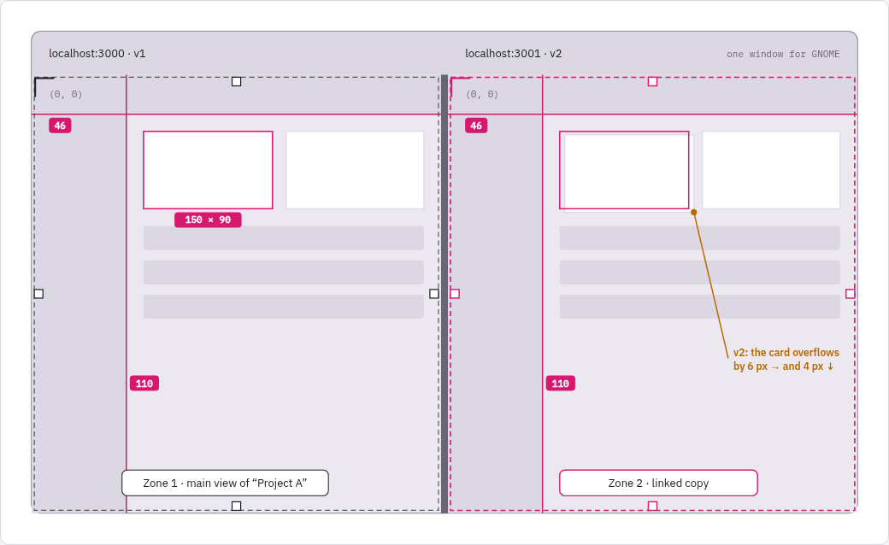
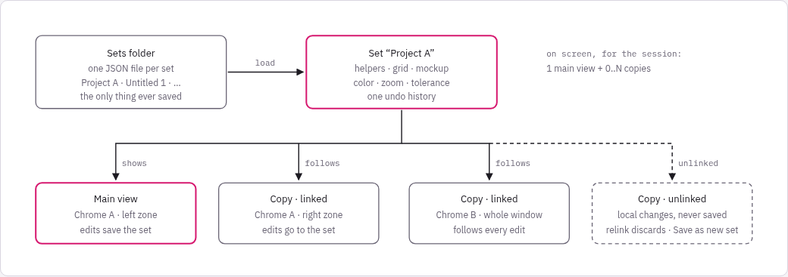
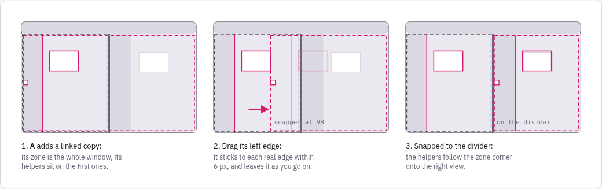
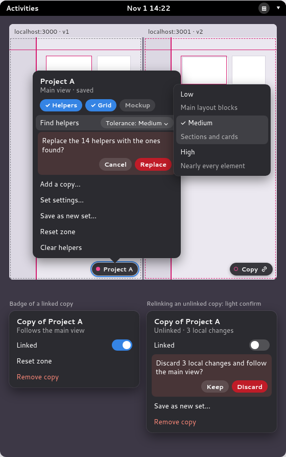
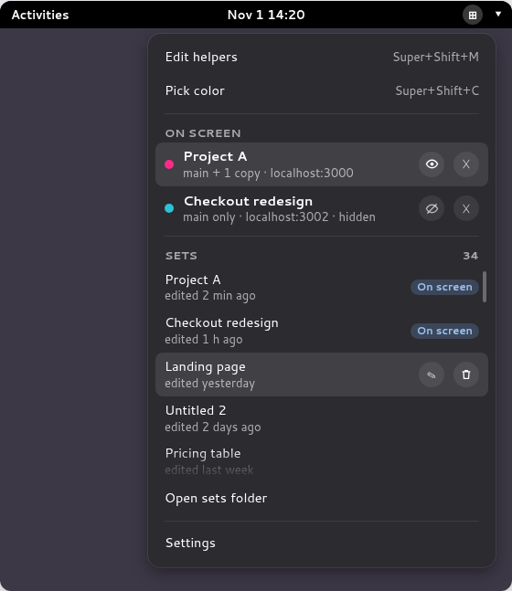
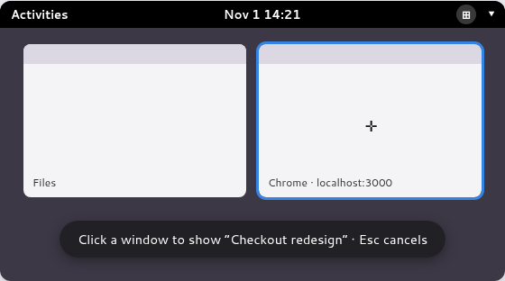
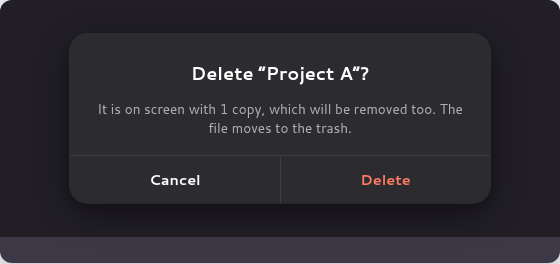
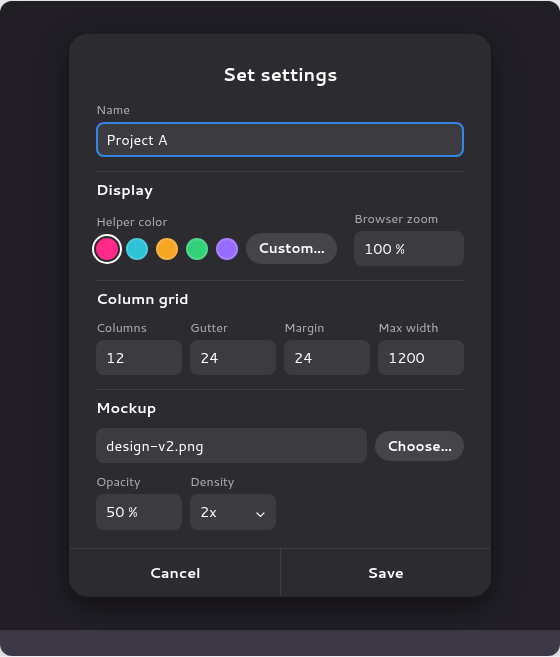
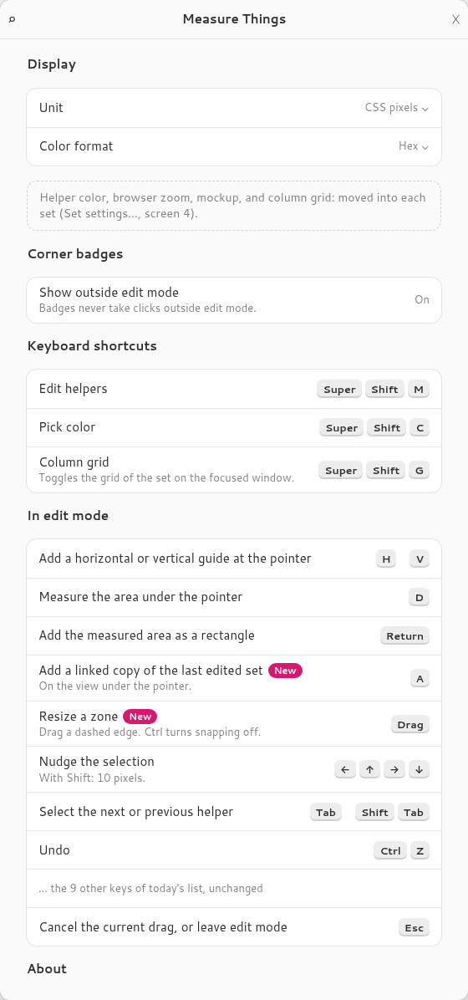

# Measure Things — SET specification (v0.3)

Spec code: `SET`, window-scoped helpers in saved sets, planned for v0.3. It builds on `PIX`. Its
implementation plans are `SET-P1` to `SET-P4`, one PR each, described in issue #8.

## Goal

Measure and check the alignment of any UI element on screen, a web page in a browser above all,
without leaving the page. Version 0.3 ties the helpers to the page they measure: helpers belong to
a window, or to a zone of it, they are kept in saved sets, and one set can show on several windows
or views at once. Comparing two versions of a page, side by side in two windows or in the two views
of a Chrome split view, then shows layout regressions at a glance.

The images are mockups. Where an image and the text disagree, the text wins.

## Audience and environment

- Web and UI developers on GNOME Shell 49, Wayland.
- Single and multi-monitor setups, at any monitor scale, fractional ones included.

## Vocabulary

- **Set**: a saved collection of helpers with its column grid, mockup, and display settings. A
  set is one file in the sets folder. Sets are the only thing Measure Things saves.
- **View**: a set shown on a window, inside a zone of that window.
- **Zone**: the rectangle of a window a view is drawn in. It is the whole window by default.
- **Main view**: the one view of a set on screen whose edits save the set.
- **Copy**: any other view of the same set. Copies last for the session and are never saved.
  A copy is **linked** or **unlinked**.

## Sets

- A set holds:
  - a name;
  - guides and rectangles;
  - the helper color and the browser zoom;
  - the column grid settings, and whether the grid shows;
  - the mockup: image path, position, opacity, pixel density, and whether it shows;
  - whether the helpers show outside edit mode;
  - the last tolerance used by **Find helpers**.
- Sets live in `$XDG_DATA_HOME/measure-things/sets/`, one JSON file per set, named after its ID.
  Each file holds a stable ID, a schema version, a revision, and the time it was last edited or
  loaded.
- Every change is committed when a gesture ends, or when a discrete command runs: a drag released,
  a key, a menu action, the settings dialog saved. A pointer motion never writes. A commit
  rewrites the file atomically, with `Gio.File.replace_contents` and the etag of the last read,
  and increments its revision.
- A file is identified by its name, `<id>.json`. The shell watches the folder:
  - A new file whose name matches the ID it holds, and whose ID is free, appears in the library.
  - Any other new file, such as a copy of an existing set or a file named differently, is an
    import: it gets a fresh ID, and is renamed to `<new id>.json`.
  - A change to an existing file by another program replaces the set in memory. A gesture in
    progress on that set is cancelled, an open **Set settings** dialog for it closes without
    saving, and the set's undo history starts over. A notice says so.
  - A commit whose etag no longer matches the file is dropped: the file on disk wins, and is
    reloaded as above.
  - A file removed there removes its set: its views leave the screen.
- A file that cannot be read, is invalid, is over the size limit, or has a newer schema version,
  shows as unavailable in the library. It is never written to and cannot be loaded. When a set on
  screen becomes unavailable, its views leave the screen with a notice.
- A set has at most 1,000 helpers, and its file at most 1 MiB. An action that would go past a
  limit is refused with a notice.
- Two sets never share a name. A name that is already taken gets a numeric suffix, `Project A 2`,
  when a set is created, renamed, or found in the folder.
- Nothing reattaches after a restart: windows have no stable identity. The user loads a set onto
  a window from the menu.

### New sets

- The first committed content action at a point of a window that no zone covers creates a set
  named `Untitled N`, with N one more than the highest existing `Untitled` number. That window
  becomes its main view, with an automatic zone. This covers a window without any view, and the
  part of a window that its fixed zones leave uncovered.
- The content actions are adding a helper (drawing, `H`, `V`, `Enter` on a measured area) and
  turning the grid on (`G`, or the grid shortcut on the focused window). Entering edit mode,
  moving the pointer, and cancelling create nothing. A mockup needs an existing set: it is chosen
  in **Set settings**.
- A new set gets the next color of the palette that no set on screen uses: `#ff2d95`, `#2ec2d6`,
  `#f5a623`, `#33d17a`, `#9a6bff`. When all five are on screen, it takes the first.
- Other defaults: browser zoom 100%, grid of 12 columns, 24 px gutter, 24 px side margin, full
  width, grid hidden, no mockup (opacity 50% and density 1x once one is chosen), helpers shown,
  tolerance Medium.

## Views and copies

- A set on screen has one main view and any number of copies. Several sets can be on screen at
  once, such as set A on the left view of a window and set B on the right one.
- A window can hold several views. Each has its own zone.
- Editing the main view saves the set, and every linked copy follows live, during the drag.
- A **linked** copy shows the set. Editing a linked copy edits the set, exactly as if the main
  view had been edited.
- An **unlinked** copy holds a full copy of the set's content (everything listed under
  [Sets](#sets) but the name), taken when it is unlinked. From then on, changes to the set don't
  reach it, and its own changes don't reach the set. They stay in memory and are never saved.
- An unlinked copy's **local changes** are its commits since it was unlinked, minus the ones it
  undid. Its badge shows their count.
- **Relinking** a copy without local changes is immediate. With local changes, a light
  confirmation comes first, in place: *Keep* leaves the copy unlinked and unchanged, *Discard*
  drops its changes and the copy shows the set again.
- **Save as new set…** asks for a name in a dialog, prefilled with the set's name followed by a
  numeric suffix. The new file is written first. If the write fails, nothing changes.
  - On an unlinked copy, the copy becomes the main view of the new set, with its content and its
    undo history. The original set and its other views don't change.
  - On the main view, the set's current content is saved under the new name. The main view, its
    linked copies, and its unlinked copies switch to the new set, with their zones, hidden state,
    local changes, and undo histories. The old set keeps what its file last held.
- **Add a copy…** closes the menu and shows a crosshair. A click on a window adds a linked copy
  there, with an automatic zone. `Esc` cancels.
- `A` in edit mode adds a linked copy of the set edited last, on the window under the pointer.
  The set edited last is the set of the last committed content change, made on its main view, a
  linked copy, or an unlinked copy. Before any such change, it is the set loaded or created last.
  When that set leaves the screen, `A` shows a notice and does nothing until another set is
  edited.
- **Remove copy** removes one copy. When it is unlinked with local changes, a light confirmation
  comes first.
- When the main view's window closes, the oldest linked copy becomes the main view. Without a
  linked copy, the set leaves the screen, and its unlinked copies leave with it.
- Undo history belongs to the set: the main view and its linked copies share it. An unlinked copy
  starts its own when it is unlinked. Relinking or removing the copy drops it. See
  [Undo](#undo) for what it covers.

## Rendering

- A view draws its helpers inside its window, as children of the window's actor, clipped to its
  zone. Helpers move with the window. Windows in front hide them. They follow the window across
  workspaces, and hide while it is minimized. No line crosses the whole screen any more.
- A view's actors are attached to the window only while it shows something. Mutter does not scan
  out a window directly when its actor has an extra child, even a hidden one.
- Popups that a page draws inside its own content, such as HTML dropdowns, stay beneath the
  helpers. Native popup menus show above them.
- Views of one window stack the largest zone at the bottom and the smallest on top, the newest on
  top among equal sizes, so the view drawn on top is the one edit mode targets. Badges stack above
  every view of their window.
- Outside edit mode nothing is reactive: clicks, scrolling, and hovering reach the window below.

## Coordinates and units

- Helper geometry is stored in CSS pixels, relative to the top-left corner of the zone, at the
  set's browser zoom. A view converts it to stage pixels with the zoom and, in physical layout
  mode, the scale of the monitor under its zone's center. A set therefore looks the same on any
  window, monitor, or scale, and changing the set's zoom rescales its helpers around the zone's
  corner, as the page does.
- Positions in labels, the readout, and `Ctrl+C` are relative to the zone's top-left corner.
  Sizes and distances use the display unit.
- **CSS pixels** (default): CSS pixels at the set's browser zoom. **Device pixels**: physical
  screen pixels. Values are rounded to two decimals, without trailing zeros.
- Layout mode comes from Mutter's `scale-monitor-framebuffer` feature, as in v0.2.
- Interaction steps and tolerances stay in stage pixels, as in v0.2: arrow nudges (1, or 10 with
  `Shift`), the 3-pixel drag threshold, the 4-pixel edge and handle boxes, the 6-pixel snapping
  distance, the 1-pixel minimum rectangle size, and mockup moves. The result of a gesture is
  converted to CSS pixels and stored rounded to two decimals.

## Zones

- A new view's zone is **automatic**: it is the whole window, and follows its resizes.
- In edit mode a zone shows as a dashed frame, with a handle in the middle of each edge, drawn
  inside the window.
- Dragging an edge resizes the zone, with snapping to screen edges anywhere in the window frame
  (`Ctrl` turns it off), and makes the zone **fixed**. Nothing is detected automatically: the edge
  stays where it is released.
- While an edge is dragged, the zone stays within the window frame and at least 40 × 40 stage
  pixels, or the whole frame when the window is smaller.
- A fixed zone keeps its stored position and size, relative to the window's top-left corner, when
  the window is resized or a split view's divider moves. What shows, and what edit mode targets,
  is its intersection with the window frame. When that intersection is empty, the view shows
  nothing, and **Reset zone** in its badge brings it back.
- **Reset zone** makes the zone automatic again. It is unavailable while the zone is automatic.
- Helpers always follow the zone's top-left corner. The workflow is to frame the zones first,
  then place the helpers.
- A helper outside its zone is hidden, but still stored.
- Hit testing, `Tab` cycling, area measuring, helper snapping, and gap labels stay within the
  zone's visible part.
- Zones are session-only, like views.

## Helpers

- A vertical guide is a 1-pixel line across its zone at an x position, labeled `x <position>` at
  the top of the zone. A horizontal guide is the same at a y position, labeled `y <position>` at
  the left of the zone.
- Neighboring parallel guides show the distance between them on a line joining them.
- A selected rectangle shows the distance to its nearest neighbor on each side: a guide, or a
  rectangle that overlaps it across the gap. Touching or overlapping neighbors show nothing.
- A rectangle is a 1-pixel outline with a light fill, labeled with its size, `width × height`,
  below it, or above its bottom edge when its zone ends first. When selected, it also shows its
  top-left position and corner handles.
- Helpers use the set's color.

## Edit mode

- Entered with the edit shortcut (`Super+Shift+M`), **Edit helpers**, or a click on a set in
  the menu's **On screen** list. It takes a modal grab. When another grab holds the keyboard, it
  does not start.
- Edit mode shows every view, hidden sets included, and every badge.
- **Targeting**: the target is the topmost visible window under the pointer. Inside it, the
  target is the smallest zone under the pointer, the newest on equal sizes. The panel, the
  desktop, and the overview are never targets, and a popup in front of a window blocks it. A zone
  edge handle wins over helpers within its 4-pixel handle box.
- A point of a window that no zone covers targets the window alone. There, drawing, `H`, `V`,
  `Enter`, and `G` create a set (see [New sets](#new-sets)), `A` adds a copy, and the other keys
  do nothing.
- The selection belongs to one view. When the target changes to another view, the selection is
  cleared. Copy, nudge, delete, and `Tab` act on the target view's selection only.
- A gesture latches its view, set, helper, and coordinate transform when it starts, and keeps them
  until it ends. If the target window moves, resizes, changes scale, or changes monitor during the
  gesture, the gesture is cancelled, as with `Esc`.
- The pointer is a crosshair with lines across the monitor and a readout of the position
  relative to the target zone. Over no window, the readout shows nothing. A hint bar lists the
  keys.
- Dragging on empty space, or inside a rectangle that is not selected, draws a rectangle once the
  pointer has moved 3 pixels. A click without drag selects the rectangle under the pointer, or
  clears the selection.
- Dragging a guide moves it along its axis. Dragging a rectangle edge or corner resizes it, within
  4 pixels of the edge. Dragging past the opposite edge flips it, and it keeps at least 1 pixel.
  Dragging inside the selected rectangle moves it. The topmost helper wins.
- **Snapping**: a dragged guide, rectangle edge, corner of a new rectangle, or zone edge snaps to
  the nearest screen edge within 6 stage pixels. A screen edge is the boundary between two pixels
  whose colors differ by more than 12 on a channel. Vertical edges are searched on the pointer's
  row, horizontal ones on its column: within the zone's visible part for helpers, within the
  window frame for zone edges. Moving a whole rectangle does not snap. Holding `Ctrl` while dragging turns snapping off.
- **Measuring areas**: `D` toggles area measuring. The crosshair is replaced by the extent of the
  pixels that share the color under the pointer, along its row and column within the zone, with
  their width and height. `Enter` adds a rectangle on that area.
- Keys, on the target view:
  - `H`/`V` add a guide at the pointer.
  - Arrows nudge the selection by 1 pixel, 10 with `Shift`. `Alt`+arrows resize the selected
    rectangle from its right or bottom edge.
  - `Tab` and `Shift+Tab` cycle the selection. `Delete` and `Backspace` remove it.
  - `Ctrl+C` copies the selected rectangle's size or the guide's position.
  - `D` toggles area measuring, and `Enter` adds the measured area.
  - `A` adds a linked copy of the set edited last.
  - `G` toggles the set's grid.
  - `Ctrl`+arrows and a secondary-button drag move the mockup. `[` and `]` change its opacity.
  - `Esc` cancels a gesture in progress, otherwise leaves edit mode.
- Edit mode and the color picker capture the screen without the extension's views and badges,
  and restore them on cancel or failure.

## Undo

- `Ctrl+Z` undoes the last change of the target view's set, or of the target copy when it is
  unlinked. `Ctrl+Shift+Z` and `Ctrl+Y` redo it.
- Undo covers the set's content only: helpers, grid, mockup, chips, color, zoom, name, and
  tolerance. Each commit that changes it is one step: a gesture, a key, **Clear helpers**,
  **Find helpers**, **Set settings** saved.
- Session state is not undoable: zones, linking, adding or removing views, hiding, loading, and
  **Save as new set…**. Renaming and deleting from the library are not undoable either.
- Undoing a rename to a name that has been taken since gets a numeric suffix.
- A history keeps 100 states and lasts for the session.

## Corner badge

- Each view shows a small badge in the bottom-right corner of its zone:
  - a main view shows a filled dot in the set's color and the set's name;
  - a copy shows a hollow dot, `Copy`, and a link icon when it is linked.
- Outside edit mode, the badge is visible but never takes input. The preference **Show outside
  edit mode** hides it there. A hidden set hides its badges too.
- In edit mode a click on a badge opens its menu, anchored to the badge. It closes with `Esc`, a
  click outside, or an action.
- The badge menu is the only place where a set is changed, apart from editing helpers.

### Main view badge menu

- Header: the set's name, then `Main view · saved`, or `Main view · not saved` after a failed
  write.
- Chips, each saved with the set and applying to the main view and its linked copies:
  - **Helpers**: shows the guides and rectangles outside edit mode. Edit mode always shows them.
  - **Grid**: shows the column grid.
  - **Mockup**: shows the mockup image. Unavailable until the set has an image.
- **Find helpers**, with a **Tolerance** list (see [Find helpers](#find-helpers)).
- **Add a copy…**, **Set settings…**, **Save as new set…**, **Reset zone**, **Clear helpers**.

### Copy badge menu

- Header: `Copy of <set>`, then `Follows the main view` when linked, `Unlinked` without local
  changes, or `Unlinked · <n> local changes`.
- **Linked** switch.
- **Reset zone**.
- **Save as new set…**, on an unlinked copy only.
- **Remove copy**.

## Panel menu

The panel menu manages the sets: which ones are on screen, and the library.

- **Edit helpers** and **Pick color**, with their shortcuts.
- **On screen**: one row per set on screen. Up to 5 rows show, then the list scrolls. Each row
  shows:
  - a dot in the set's color and the set's name;
  - its main view's window title and the number of copies, and `hidden` when hidden;
  - an **eye** button that hides or shows the whole set, its main view and copies, outside edit
    mode. Hiding is a session state and is not saved;
  - a **✕** button that removes the set from the screen, with its main view and all its copies.
    When unlinked copies have local changes, a light confirmation comes first, in the menu. The
    set itself is already saved.
- A click on a row activates the main view's window, switching workspace or unminimizing it as
  needed, then enters edit mode and opens the badge menu of the set's main view. A hidden set
  shows again.
- The **On screen** section hides when no set is on screen.
- **Sets**: the library, every set, most recently edited or loaded first. Up to 5 rows show, then
  the list scrolls. Each row shows the set's name and when it was last edited. A set on screen
  shows `On screen`. An unavailable file shows `unavailable` and does nothing.
  - A click loads the set (see [Loading a set](#loading-a-set)).
  - On hover, **rename** opens a dialog with the name, and **delete** asks for confirmation.
  - An empty library shows `No sets yet. Draw on a window to start one.`
- **Open sets folder** opens the folder in the file manager. Copying a file there imports a set,
  and copying one out exports it.
- **Settings** opens the preferences.

### Loading a set

- The menu closes, the pointer becomes a crosshair, and the window under it is highlighted. An
  on-screen hint reads `Click a window to show “<set>” · Esc cancels`.
- A click on a window shows the set there:
  - when the set is not on screen, as its main view, with an automatic zone, even if the window
    already shows another set;
  - when the set is on screen, as a linked copy.
- `Esc`, or a click outside any window, cancels.

### Deleting a set

- A dialog asks `Delete “<set>”?`. When the set is on screen, it says how many views will leave.
- **Delete** moves the file to the trash. Its main view and copies leave the screen at once. Its
  ID is remembered for the session, so a late save never recreates it.

## Set settings

**Set settings…** opens a modal dialog in the shell:

- **Name**.
- **Display**:
  - **Helper color**: the five palette colors, and **Custom…**, which shows a hex entry.
  - **Browser zoom**: 25% to 500%.
- **Column grid**: columns (1 to 24), gutter (0 to 400), side margin (0 to 800), and maximum
  width (0 to 10,000, 0 for full width), in CSS pixels at the set's zoom.
- **Mockup**:
  - the image, chosen with **Choose…** through the desktop's file chooser portal
    (`org.freedesktop.portal.FileChooser`), and **Remove**, which clears it;
  - opacity, 5% to 100%;
  - pixel density, 1x to 4x.
- While the file chooser is open, the dialog releases its modal grab and keeps its draft, and
  edit mode is left. When the chooser closes, the dialog takes its grab back. Cancelling the
  chooser, or a portal error, keeps the previous image; an error also shows a notice. Disabling
  the extension closes the dialog without saving.
- **Save** applies everything as one commit, and one undo step. Choosing a new image turns the
  **Mockup** chip on, as in v0.2. Removing it turns the chip off. **Cancel** changes nothing.

## Column grid

- Shown with the set's **Grid** chip, the grid shortcut (`Super+Shift+G`), or `G` in edit mode.
- The shortcut toggles the grid of the set shown on the focused window. When that window shows
  several sets, it toggles the set of the newest view. When it shows none, it creates a set with
  the grid on (see [New sets](#new-sets)).
- Each view draws the grid in its zone. The container is the zone width, or the maximum width
  when it is set and smaller, centered. The margin pads both sides, and the columns share the
  remaining width after the gutters.

## Mockup

- The set's image is drawn in each of its views at its CSS size: one image pixel per CSS pixel,
  or fewer at a pixel density of 2x to 4x, at the set's zoom. It is clipped to the zone, and lets
  the pointer through.
- Its position is stored in CSS pixels relative to the zone's corner. In edit mode a
  secondary-button drag or `Ctrl`+arrows (10 pixels with `Shift`) move it, and `[` and `]`
  change its opacity by 10%.
- When the image file is missing, the mockup turns off with a notice. Its path stays in the set.

## Find helpers

- **Find helpers** in the main view's badge menu places guides on long edges and rectangles
  around uniform regions, found in the pixels of the main view's zone. Linked copies receive them
  like any edit, which is the point: comparing the found helpers with another version reveals its
  regressions. It is not offered on copies. Running it on each view would align the helpers to
  each version and hide the difference.
- **Tolerance** sets how much it finds:
  - **Low**: the main layout blocks;
  - **Medium**: sections and cards;
  - **High**: nearly every element.

  Each level has fixed parameters, tuned on test images. The choice is saved with the set.
- When the set already has helpers, a light confirmation comes first, in the badge menu:
  `Replace the <n> helpers with the ones found?`, with *Cancel* and *Replace*. The found helpers
  replace the existing ones.
- A run takes a fresh capture of the zone, with the badge menu and every view and badge of the
  extension hidden for that paint, then shows them again.
- When it keeps more than 60 candidates, it keeps the strongest: the longest edges and the largest
  regions, ties broken by position, top to bottom then left to right.
- Changing the tolerance right after **Find helpers**, before any other edit, runs it again and
  replaces its result without asking.
- `Ctrl+Z` undoes it in one step.
- When another window covers part of the zone (by the window stacking), the capture fails, or the
  result is stale (see [Lifecycle](#lifecycle)), nothing changes: the helpers and the history stay
  as they were, and a notice says why.

## Color picker

- Started with the picker shortcut (`Super+Shift+C`) or **Pick color**. It leaves edit mode first
  and returns to it afterwards.
- The extension's views and badges are hidden while it runs. A swatch next to the pointer shows
  the 11 × 11 device pixels around it, magnified 10 times with the center one framed, then the
  color and value of the pixel under the pointer. The swatch itself is never sampled.
- The value is in the preferred color format: hex (`#rrggbb`, default), `rgb(r, g, b)`, or
  `hsl(h, s%, l%)`. `Tab` switches to the next format and keeps it.
- A primary click copies the value to the clipboard and confirms with an on-screen display. `Esc`
  or a secondary click cancels.

## Preferences

The preferences only customize the extension. They hold no set content.

- **Display**: unit and color format.
- **Corner badges**: **Show outside edit mode**, on by default.
- **Keyboard shortcuts**: edit helpers, pick color, and column grid, as in v0.2. A row shows its
  keys. Activating it asks for the new combination, which must hold Ctrl, Alt, or Super.
  Backspace disables the shortcut, and Escape keeps it.
- **In edit mode**: the read-only list of keys, as in v0.2, with two new rows: `A`, and resizing a
  zone by dragging its dashed edge. `Ctrl+F` searches the rows.
- **About**: version and source code.
- Helper color, browser zoom, grid settings, and the mockup moved into each set's settings.

## Lifecycle

- **A window closes, is minimized, or leaves the workspace during a gesture**: the gesture is
  cancelled, as with `Esc`. Pending snapping reads are dropped, the selection is cleared, and
  signals are disconnected. Committed changes stay saved.
- **A set is deleted, or its file removed or made unavailable, while shown**: a gesture in
  progress on it is cancelled, and its views leave the screen at once.
- **Snapshot**: it records the geometry it was taken with. A move, resize, scale change, or
  monitor change of the target view takes a new snapshot after the gesture is cancelled, and
  stale reads are dropped.
- **A write fails**: a notice says so, the set stays in memory, the main view's badge header reads
  `Not saved`, and the next commit tries again.
- **Find helpers** drops its result when the set, the zone, or the window changed while it ran.
- **Disabling the extension** cancels any gesture in progress, removes every view and badge, and
  keeps every set.
- The overview and window switcher previews clone window actors with their children, so they may
  show the views. That is acceptable.

## Migration from v0.2

- On the first start of v0.3, when the v0.2 settings hold helpers, a mockup image, or non-default
  grid settings, they become one new set, named `Untitled 1` with the usual suffix rule:
  - every position is taken relative to the primary monitor's top-left corner, guides,
    rectangles, and the mockup alike, so the layout keeps its shape. Values are converted from
    stage pixels to CSS pixels with the v0.2 browser zoom and, in physical layout mode, the
    primary monitor's scale. Negative positions are kept, and are hidden until a zone reaches
    them;
  - the helper color and browser zoom become the set's;
  - the grid settings and the mockup image, opacity, density, and visibility come along. The
    helpers' visibility comes from **Show helpers**.
- The set is not shown: the user loads it.
- The set file records that it comes from the migration. The migration marker is written only
  after that file is saved. On start, a missing marker with such a file already present writes
  the marker and creates nothing, so an interrupted migration never makes two sets.
- The old keys stay untouched for one release, then go.

## Out of scope for v0.3

- A diff mode that finds helpers on two views and highlights the edges that moved.
- Detecting split views automatically, through accessibility.
- Reattaching views to windows after a restart.
- Embedding mockup images in set files.
- Snapping to other helpers, several mockups per set, and blend modes.
- Keeping undo history across restarts.
